# Two-dimensional mixed-grid acoustic solver: validation report

## 1. Scope and conclusion

The node-centered acoustic solver under `src/acoustic/` was verified on four classical problem classes with closed-form reference solutions:

1. a standing mode in a rigid rectangular cavity;
2. a harmonic plane wave in a stationary medium;
3. a harmonic plane wave in a uniform mean flow;
4. a directed Gaussian pulse with absorbing and rigid outlets.

All 14 configured runs completed, all automated acceptance checks passed, and every mesh passed the dual-area and shape-function gradient checks. The mixed-grid cavity, stationary plane-wave, and convected plane-wave errors decrease at approximately second order under simultaneous mesh/time-step refinement. On the finest grids, their relative area-weighted L2 errors are **0.0628%**, **0.1050%**, and **0.2439%**, respectively. The refined Gaussian pulse has **2.0536%** relative L2 error. The measured absorbing-outlet reflection ratio is **0.2350%**, compared with **99.5585%** for the rigid-outlet control.

These are analytical verification results for the implemented discrete equations. They do not certify oblique/incident-angle absorption, non-uniform media, fluid–structure coupling, or all mesh-quality regimes.

## 2. Implemented formulation

The implementation follows `textbook/Chap5-4-acoustic.md`, especially Eqs. (5.227)–(5.258). It solves the convected acoustic wave equation

\[
\frac{1}{\rho_0c_0^2}p'_{tt}
=\nabla\cdot\left(\frac{1}{\rho_0}\nabla p'\right)
-\frac{2}{\rho_0c_0}\frac{\partial(\mathbf M\cdot\nabla p')}{\partial t}
-\frac{1}{\rho_0}\mathbf M\cdot\nabla(\mathbf M\cdot\nabla p')+\mathcal S.
\]

Pressure is nodal; density, sound speed, and Mach number are stored per cell. The current cases use a steady, spatially uniform, subsonic background. The semi-discrete system is

\[
\mathsf M\ddot p+\mathsf C\dot p+\mathsf Kp=F(t).
\]

Key implementation details are:

- median-dual control areas constructed from vertices, edge midpoints, and cell centroids;
- exact linear-triangle gradients and bilinear-quadrilateral gradients evaluated through the isoparametric Jacobian;
- full `(I - M ⊗ M)` tensor fluxes, including mean-flow cross terms;
- diagonal lumped acoustic mass, centered mean-flow mixed derivative, and optional normalized Gaussian source;
- rigid, first-order absorbing, fixed-pressure, and analytical-plane-wave boundary conditions;
- Newmark integration and the centered three-level scheme, with consistent initial acceleration and pressure-degree-of-freedom elimination;
- PETSc solution for non-diagonal systems and a direct nodal update for diagonal centered-difference systems;
- nodal Tecplot output on separate mixed triangle/quadrilateral zones, plus summary, probe, and geometry CSV files.

The implementation plan is in `src/acoustic/IMPLEMENTATION_PLAN.md`; the driver is `cases/validate_acoustic.py`.

## 3. Metrics and acceptance checks

For amplitude-one pressure, the reported field error is

\[
E_2=\sqrt{\frac{\sum_i S_i(p_i-p_{a,i})^2}{\sum_i S_i p_{a,i}^2}},
\]

where `S_i` is the nodal dual area. `Linf` is the maximum absolute nodal error. Observed order between meshes whose spacing and target time step are both halved is

\[
q=\frac{\log(E_{2,\mathrm{coarse}}/E_{2,\mathrm{fine}})}{\log 2}.
\]

Probe frequencies use linearly interpolated zero crossings. The plane-wave phase-speed estimate is `omega_h / k`. For the reflection test, the incident peak is measured at `x = 3.5` during `2.0 <= t <= 2.9`, and the reflected peak is measured at the same point for `t >= 3.1`; their absolute-peak ratio is reported.

Automated gates require finite results, area closure below `1e-9`, maximum `|sum(grad N)|` below `1e-8`, analytical field/frequency accuracy, grid-error reduction, limited cavity energy drift, Gaussian-pulse L2 error below 4%, absorbing reflection below 8%, and rigid-control reflection above 70%.

The complete machine-readable results are in `validation/acoustic_metrics.csv`; nodal and centerline comparisons are under `validation/data/`.

## 4. Geometry and mixed-element checks

The mixed meshes contain quadrilaterals in the left half and triangles in the right half, with conforming shared edges. Smooth deterministic interior-node distortion exercises the quadrilateral inverse mapping and physical gradients. Pure-triangle and pure-quadrilateral cavity runs provide separate controls.

Across all reported runs:

- maximum element-area closure error: `8.882e-16`;
- maximum shape-function gradient-sum norm: `2.247e-14`;
- no negative dual area or lumped mass was found.

| Medium-resolution cavity mesh | Nodes | Cells | Relative L2 error | Frequency error |
|---|---:|---:|---:|---:|
| Mixed triangles/quadrilaterals | 861 | 1,200 | 0.29649% | -0.24327% |
| Triangles only | 861 | 1,600 | 0.32512% | -0.12971% |
| Quadrilaterals only | 861 | 800 | 0.10548% | -0.25767% |
| Mixed, Newmark average acceleration | 861 | 1,200 | 0.28092% | -0.24962% |

The centered mixed-grid run has a final two-period energy drift of `0.09909%`; the Newmark run has `1.328e-5%`. Short-time oscillation of the centered discrete energy is not treated as instability.

## 5. Rigid rectangular cavity

The domain is `[0,2] x [0,1]`, with `rho = c = 1` and rigid walls. The initial pressure is the `(m,n) = (2,1)` mode with zero initial pressure rate:

\[
p(x,y,t)=\cos\left(\frac{m\pi x}{L_x}\right)
\cos\left(\frac{n\pi y}{L_y}\right)\cos(\omega t),
\qquad
\omega=\pi c\sqrt{(m/L_x)^2+(n/L_y)^2}=\pi\sqrt2.
\]

The solution is compared after two periods, `t = sqrt(2)`. The target time step is halved with mesh spacing; the solver divides the end time into equal steps so the centered scheme keeps a constant step.

| Grid `h` | Nodes | Cells | Relative L2 error | Maximum absolute error | Frequency error | Observed order |
|---:|---:|---:|---:|---:|---:|---:|
| 0.100 | 231 | 300 | 1.14857% | 0.020198 | -0.93648% | — |
| 0.050 | 861 | 1,200 | 0.29649% | 0.006943 | -0.24327% | 1.954 |
| 0.025 | 3,321 | 4,800 | 0.06281% | 0.001450 | -0.06041% | 2.239 |

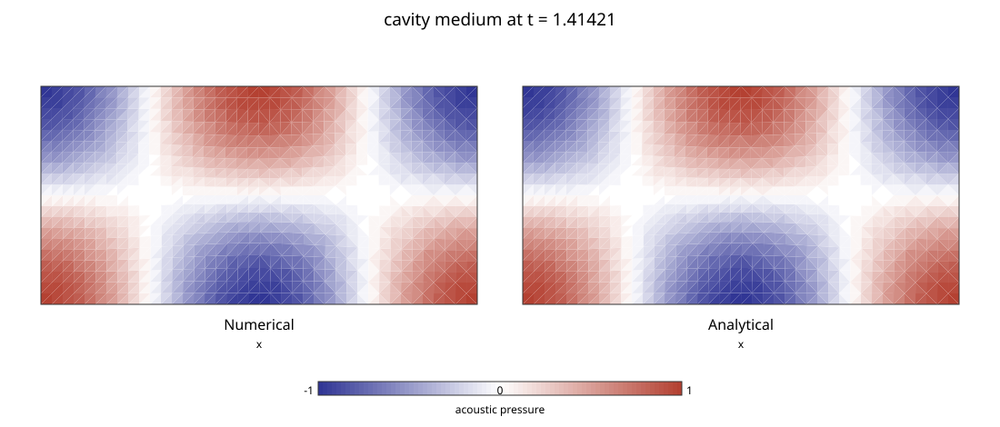

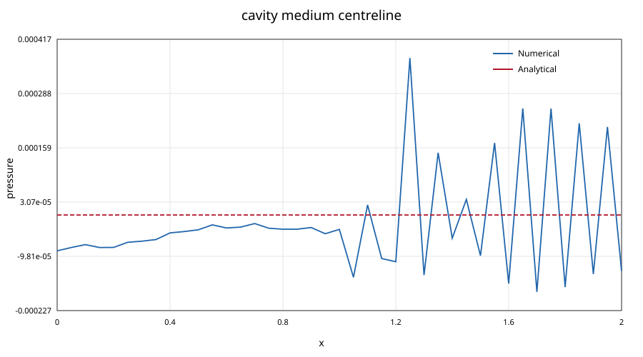

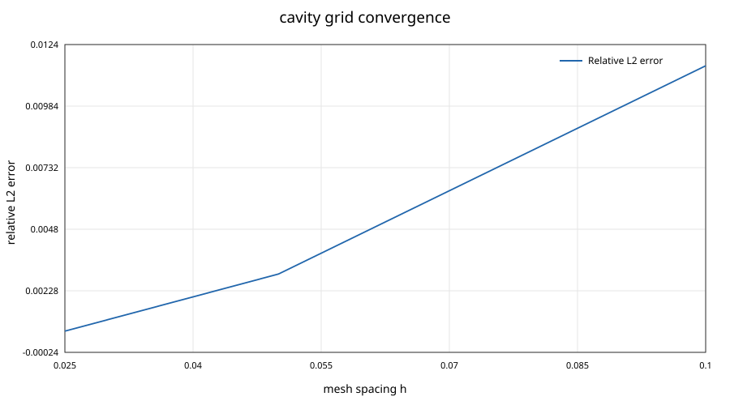

The contour pair uses the medium mixed mesh and the same color scale. Negative numerical frequency error indicates a small phase lag that decreases at approximately second order.

## 6. Plane wave without mean flow

A wave with `k = 2 pi`, direction `(1,0)`, and `c = 1` propagates through `[0,2] x [0,0.5]`. Rigid top/bottom walls make the problem two-dimensional geometrically but one-dimensional in its analytical variation. The left/right prescribed pressures use the same exact traveling wave as the interior initial condition:

\[
p=\sin(kx-\omega t),\qquad \omega=ck.
\]

The comparison is after one period, `t = 1`.

| Grid `h` | Relative L2 error | Maximum absolute error | Estimated phase speed | Observed order |
|---:|---:|---:|---:|---:|
| 0.050 | 1.69060% | 0.029753 | 0.995496 | — |
| 0.025 | 0.42118% | 0.007365 | 0.998856 | 2.005 |
| 0.0125 | 0.10500% | 0.001982 | 0.999696 | 2.004 |

The exact phase speed is `1`. This case verifies propagation amplitude and phase; prescribed end pressures are not used as evidence of absorbing-boundary performance.

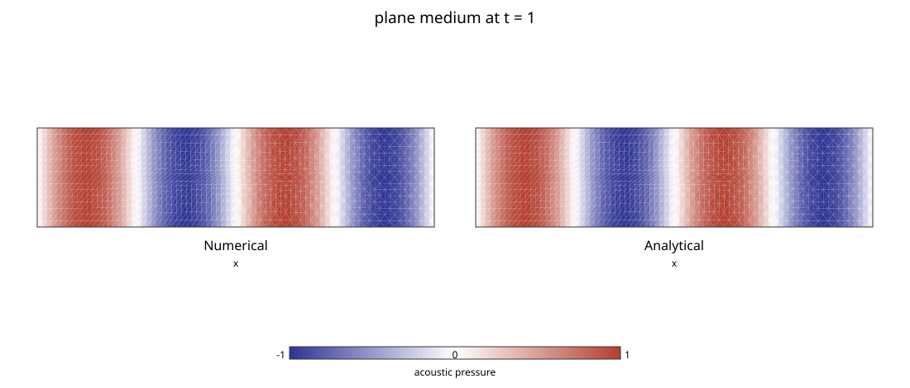

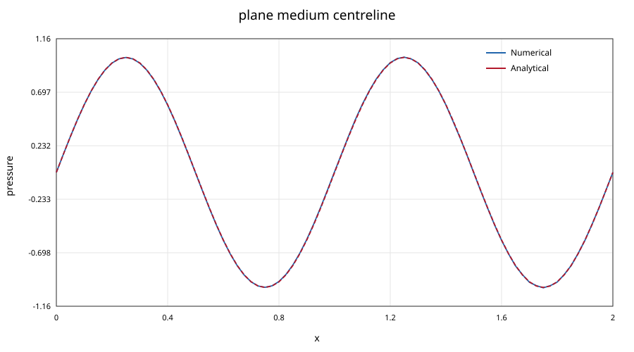

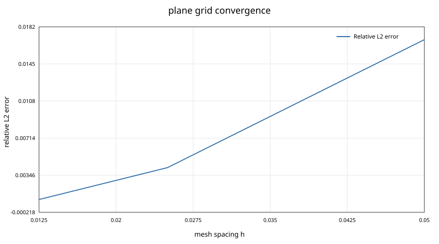

## 7. Plane wave with uniform mean flow

The stationary-plane-wave case is repeated with `U = (0.3,0)`, `M = 0.3`, and the full mixed time-space and second-order Mach-number terms. For a downstream acoustic mode,

\[
p=\sin(kx-\omega t),\qquad
\omega=ck+\mathbf U\cdot\mathbf k=2\pi(1+0.3),
\]

so the exact phase speed is `c + U_x = 1.3`, and one period is `t = 1/1.3`.

| Grid `h` | Relative L2 error | Maximum absolute error | Estimated phase speed | Observed order |
|---:|---:|---:|---:|---:|
| 0.050 | 3.95617% | 0.057944 | 1.288299 | — |
| 0.025 | 0.97730% | 0.015527 | 1.296556 | 2.017 |
| 0.0125 | 0.24392% | 0.004055 | 1.299116 | 2.002 |

The non-diagonal centered system was solved with PETSc BiCGStab/ILU. The measured downstream speed approaches `1.3`, while the second-order field convergence shows that the mean-flow matrices remain consistent with the continuous convected wave equation.

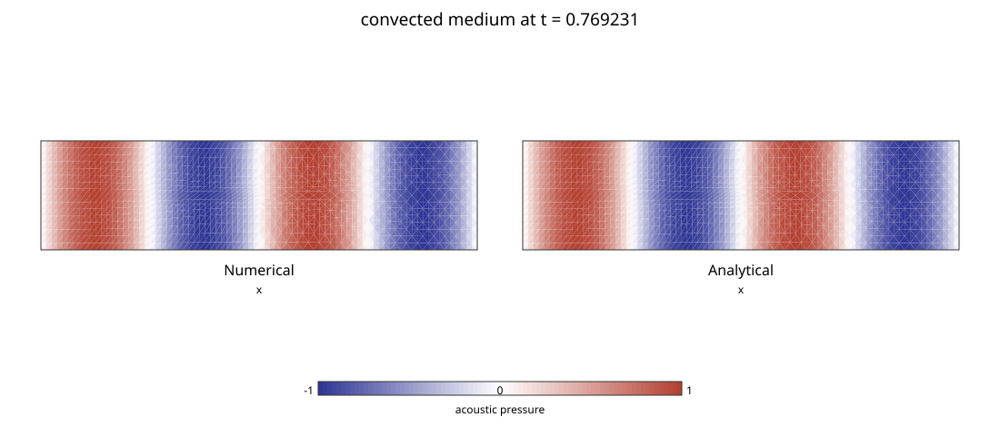

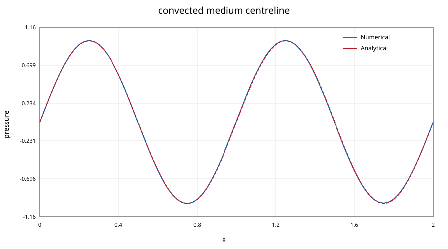

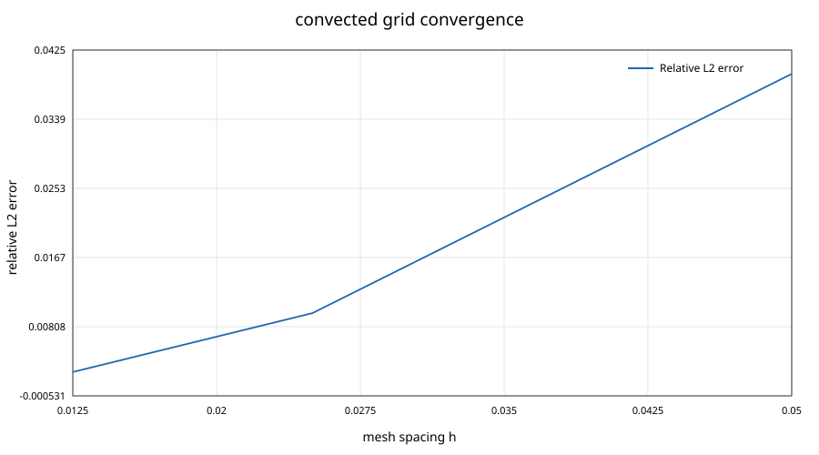

## 8. Gaussian pulse and outlet reflection

The directed initial pulse is

\[
p_0=\exp\left[-\frac{(x-1)^2}{2(0.12)^2}\right],
\qquad
p_{t,0}=-c\,\partial_x p_0,
\]

which gives the right-running reference solution `p = exp(-(x - 1 - ct)^2 / (2 sigma^2))` before boundary interaction. The domain is `[0,4] x [0,1]`; the top and bottom are rigid, and the left boundary is absorbing. The reported mesh has 6,601 nodes and 9,600 mixed cells, with `dt = 0.0025` and maximum Courant number `0.17046`.

At `t = 1`, before outlet interaction:

- relative area-weighted L2 error: **2.05364%**;
- maximum absolute nodal error: **0.0213781**;
- both rigid-outlet and absorbing-outlet runs have the same pre-interaction errors to printed precision.


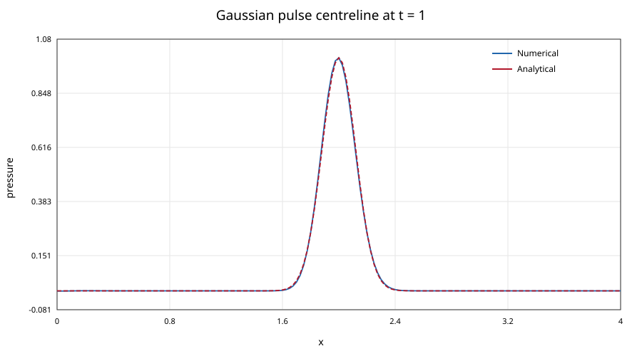

The right boundary is then changed from absorbing to rigid while all other settings remain fixed. At the `x = 3.5` probe, the measured reflected/incident peak ratios are:

| Outlet | Reflection ratio | Maximum absolute pressure at `t = 4` |
|---|---:|---:|
| Absorbing | 0.234999% | 0.00243416 |
| Rigid | 99.558540% | 0.991212 |

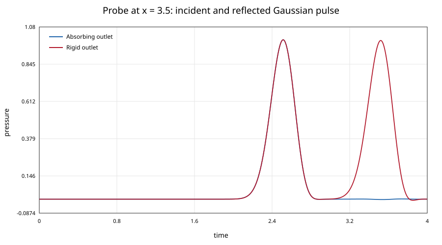

The first trace shows a small returning signal; the rigid control shows the expected large reflected pulse. This verifies the sign and dissipative behavior of the implemented normal-incidence boundary term. It is not a claim of angle-independent or near-field non-reflection.

## 9. Reproduction

From the supported WSL environment:

```bash
make -j2
make validate-acoustic
```

The target runs `cases/generate_acoustic_meshes.py`, all case inputs under `cases/acoustic_*/`, and `cases/validate_acoustic.py --run`. To regenerate comparisons and SVGs from existing results without rerunning the solver:

```bash
python3 cases/validate_acoustic.py
```

Individual examples are:

```bash
./multiphysics cases/acoustic_cavity
./multiphysics cases/acoustic_plane_wave
./multiphysics cases/acoustic_convected
./multiphysics cases/acoustic_absorbing
./multiphysics cases/acoustic_absorbing/rigid.in
```

Configuration settings and boundary syntax are documented in `README.md`.

## 10. Limitations and further work

- Execution is serial and limited to linear two-dimensional triangles and quadrilaterals.
- Background density, sound speed, and velocity are currently uniform and steady; the mean-flow form assumes the corresponding divergence-free background and `|M| < 1`.
- Lumped mass and low-order dual-face quadrature can introduce dispersion on distorted or insufficiently resolved grids. The resolution and propagation-distance sensitivity must be assessed for each application.
- The local absorbing relation is exact only for its supported outgoing characteristic model. Oblique incidence, curved wavefronts, and multiple incoming/outgoing characteristics require reflection studies or a PML; no PML is implemented.
- General frequency-dependent impedance, vibrating-wall input, frequency-domain Helmholtz solution, and fluid–structure coupling are outside the current implementation.
- The normalized volume source is implemented but is not exercised by these initial/boundary-value verification cases.
- The present analytical cases establish code verification, not experimental validation or a universal accuracy guarantee.

## 11. References

1. Project textbook, `textbook/Chap5-4-acoustic.md`, Eqs. (5.227)–(5.267).
2. COMSOL, [Gaussian Pulse in 2D Uniform Flow: Convected Wave Equation and Absorbing Layers](https://doc.comsol.com/6.4/doc/com.comsol.help.models.aco.gaussian_pulse_absorbing_layers/gaussian_pulse_absorbing_layers.html). This benchmark motivated the use of analytical pulse propagation and open-boundary comparisons.
3. Fabbri, D., Bruzzone, F., and Rosso, C., [pyCAFE: A Finite Element Framework for Solving Acoustic Problems in Python](https://openresearchsoftware.metajnl.com/articles/10.5334/jors.677), including closed-form rigid-rectangular-cavity eigenfrequency verification.
4. Newmark, N. M., [A Method of Computation for Structural Dynamics](https://doi.org/10.1061/JMCEA3.0000098), *Journal of the Engineering Mechanics Division*, 85(3), 67–94, 1959.
