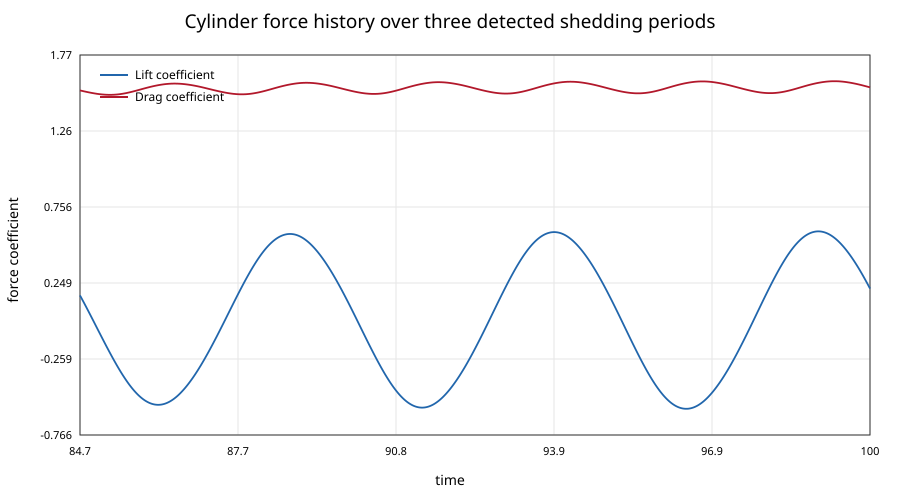
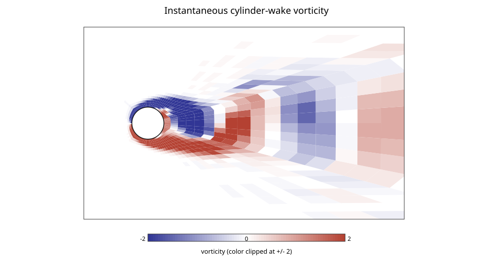
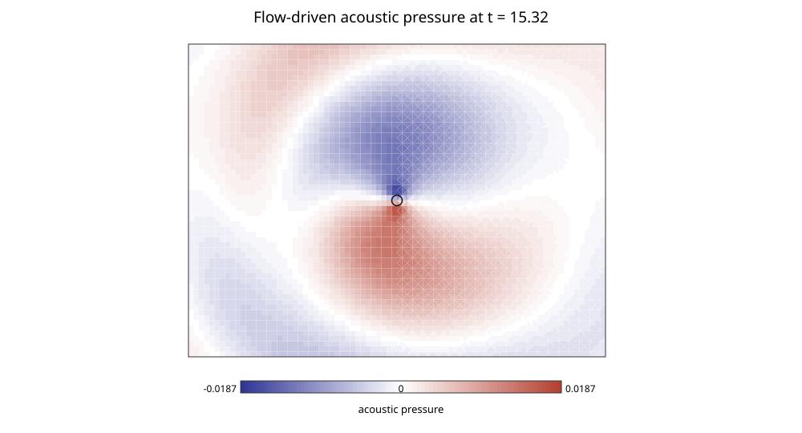
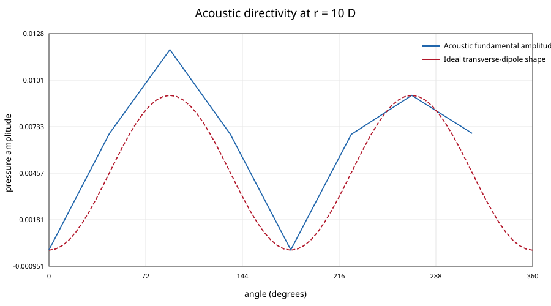

# Cylinder vortex shedding and aeolian-tone propagation

## Result summary

The one-way hybrid workflow completed successfully. The transient incompressible cylinder flow produces a Kármán vortex street, and its mean-subtracted force history drives a compact Curle-type dipole in the convected acoustic solver.

- Measured Strouhal number: **0.195715**, compared with **0.183** from Inoue and Hatakeyama (+6.95%).
- Mean drag coefficient: **1.551439**, compared with **1.32** (+17.53%).
- Lift half-range amplitude: **0.592395**, compared with **0.52** (+13.92%).
- Drag second-harmonic amplitude: **0.039358**, compared with approximately **0.026** in the reference.
- Transverse/axial fundamental acoustic amplitude ratio at `r = 10 D`: **545.043**, confirming a dominant lift dipole.

The force comparison is quantitative. The acoustic calculation verifies propagation and dipole directivity, but it is not a compressible DNS or a grid-independent far-field pressure certification.

## Benchmark and discretization

The reference is O. Inoue and N. Hatakeyama, [Sound generation by a two-dimensional circular cylinder in a uniform flow](https://metodologiauntref.wordpress.com/wp-content/uploads/2015/09/inoue2002.pdf), *Journal of Fluid Mechanics* 471, 285–314, 2002, DOI `10.1017/S0022112002002124`.

The case uses `D = U = rho = 1`, `nu = 1/150`, `Re = 150`, `c = 5`, and `M = 0.2`. The near field uses the existing 2,304-cell body-fitted quadrilateral cylinder mesh and BDF2 with `dt = 0.02`. The acoustic domain is `[-20,20] x [-15,15]`, with 4,941 nodes and 7,200 mixed triangles/quadrilaterals, centered differencing with `dt = 0.02`, and maximum Courant number `0.24`. All acoustic exterior boundaries are absorbing.

The detected shedding period is **5.10947385**. The acoustic source uses the last three detected periods, from flow time **84.680000** to **100.000000**, with the mean force removed and a one-time-unit cosine startup ramp.

## Cycle-by-cycle force development

| Cycle (oldest to latest) | Flow-time interval | Mean `Cd` | `Cl` half-range |
|---:|---|---:|---:|
| 1 | 84.6716–89.7811 | 1.545478 | 0.570460 |
| 2 | 89.7811–94.8905 | 1.552445 | 0.586018 |
| 3 | 94.8905–100.0000 | 1.556398 | 0.592395 |

These intervals show whether the selected source has reached a statistically stationary shedding state. The complete three-period harmonic fit gives a lift fundamental amplitude of **0.581224**; this differs from the half-range when amplitude is still developing.



## Near-field vortex shedding

The vorticity plot uses a fixed `+/-2` color range to keep the wake structures visible despite much larger boundary-layer values at the cylinder wall. The underlying Tecplot data are not clipped.



## Curle-type acoustic source

The flow output contains total, pressure, and viscous forces per unit span. For force `F` **of the fluid on the cylinder**, the force of the cylinder on the fluid is `-F`. With normalized compact Gaussian `g`, the acoustic right-hand side is

\[
-\nabla\cdot\left(-\frac{\mathbf Fg}{\rho}\right)
=\nabla\cdot\left(\frac{\mathbf Fg}{\rho}\right).
\]

The acoustic solver evaluates this dipole through the Gaussian gradient and linearly interpolates the measured force history. It does not use the incompressible pressure as radiating sound. Mean flow `U = (1,0)` is retained in the acoustic wave operator, so propagation includes the low-Mach Doppler effect.

## Acoustic pressure and directivity

The instantaneous contour shows alternating positive and negative pressure lobes generated by the oscillating transverse force, together with upstream/downstream asymmetry from convection.



At `r = 10 D`, the fundamental-pressure amplitudes are:

| Probe location | Fundamental amplitude |
|---|---:|
| `(0, +10)` | 0.0091842817 (mean with `(0,-10)`) |
| `(+/-10, 0)` | 1.6850561e-05 (mean of both axial probes) |



The directivity comparison normalizes the ideal transverse-dipole shape to the measured transverse amplitude. Axial probes also include weaker drag-dipole and near-field/numerical contributions, so the ideal curve is a shape reference rather than an exact error norm.

## Reproduction

```bash
make -j2
make cylinder-aeolian
```

To reuse the existing near-field result and rerun only acoustics:

```bash
python3 cases/run_cylinder_aeolian.py --acoustic-only
```

The machine-readable summary is `validation/cylinder_aeolian_metrics.csv`. Detailed force and probe data are under `validation/data/`; case-specific settings and source conventions are in `cases/cylinder_aeolian/README.md`.

## Limitations

- This is one-way Curle-type coupling, not two-way fluid–acoustic coupling or compressible DNS.
- The coarse near-field mesh and bounded flow domain affect force amplitudes even though the shedding frequency is accurate.
- The compact Gaussian dipole is a regularization of the cylinder loading; its width and the acoustic grid affect near-source pressure amplitudes.
- The acoustic domain is much smaller than the reference DNS radiation domain. First-order absorbing boundaries and low-order mixed-grid dispersion limit far-field comparisons.
- Acoustic pressure amplitudes are therefore reported for this implementation's source and domain, not asserted to match the reference DNS point-for-point.
