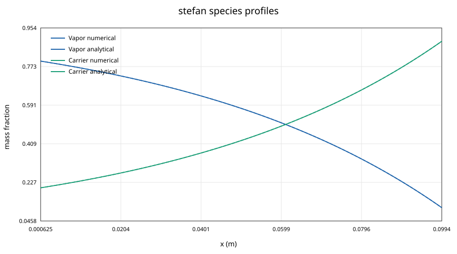
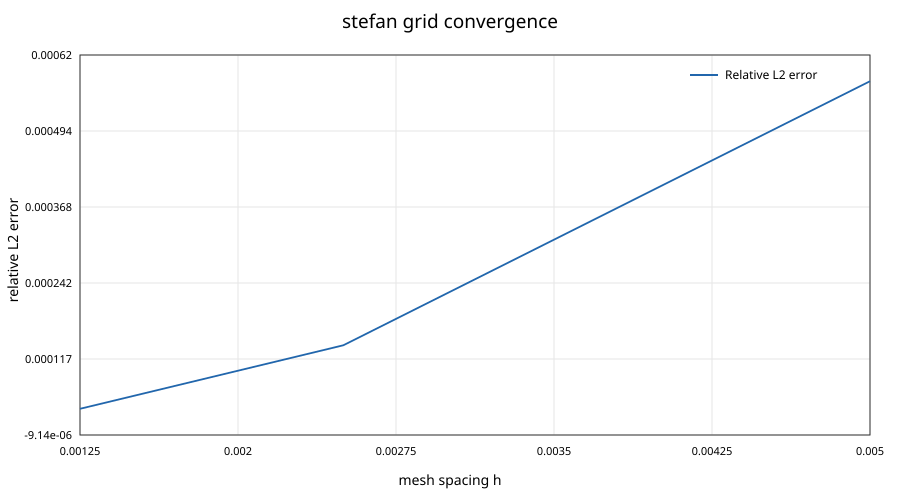
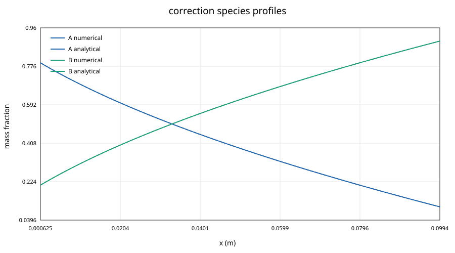
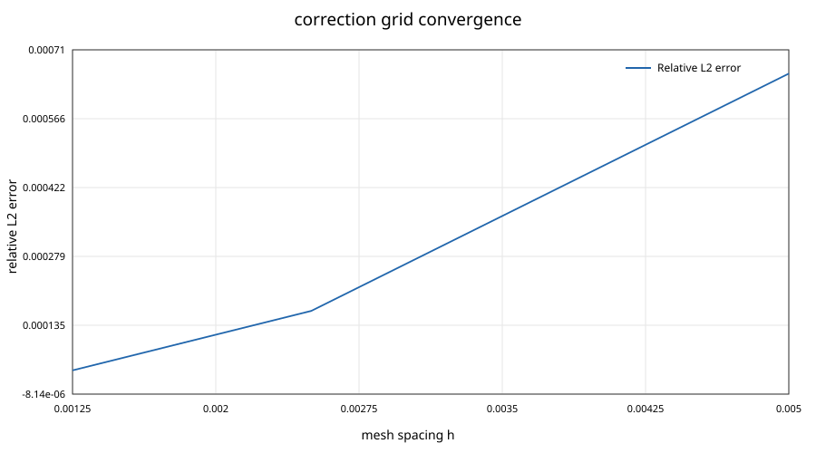
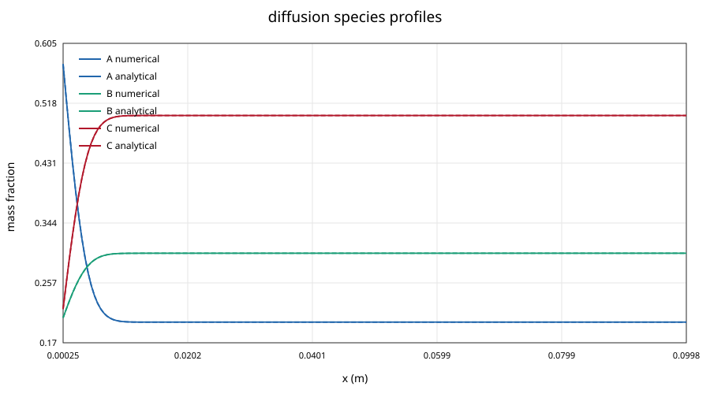
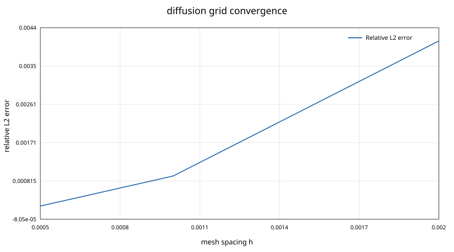

# Multispecies and material framework: verification and validation report

## 1. Scope and conclusion

This report covers the first implemented stage of the multiphase/multispecies framework described in `textbook/Chap5-2-SIMPLE-scheme-multiphase-multispecies.md`:

- an independent material interface with constant-fluid, ideal-gas-mixture, and volume-fraction property models;
- inert multispecies transport coupled passively to the existing constant-density SIMPLE solver;
- conservative mixture-averaged diffusion with a unit-sum species constraint;
- VOF, algebraic-slip, Euler–Euler, and DPM interfaces whose solve routines remain intentionally unimplemented.

All **10 configured runs passed** the automated convergence, analytical-error, grid-refinement, conservation, boundedness, composition-closure, and material-property checks. The finest-grid relative L2 errors are:

| Analytical family | Relative L2 error | Last observed grid order |
|---|---:|---:|
| Binary Stefan tube | `3.41245e-5` | 2.021 |
| Unequal-diffusivity flux correction | `4.13585e-5` | 1.999 |
| Three-species transient diffusion | `2.28298e-4` | 2.027 |

The output composition error `max(abs(sum(Y_k)-1))` is zero at printed precision for every case. These are analytical verification and material-rule checks. They are not full Maxwell–Stefan, reacting-flow, composition-driven low-Mach, or multiphase validation.

## 2. Framework and ownership

### 2.1 Material module

`src/material/` defines `MaterialState`, `MaterialProperties`, `SpeciesProperties`, and the `MaterialModel` interface. Material implementations do not own flow fields or discretization operators.

| Class | Implemented behavior |
|---|---|
| `ConstantMaterial` | Positive constant density and non-negative viscosity, conductivity, and heat capacity. |
| `IdealGasMixture` | Mass/mole conversion, ideal-gas density, Wilke viscosity, arithmetic/harmonic conductivity, mass-weighted heat capacity, and constant or mixture-averaged diffusivity. |
| `VolumeFractionMixture` | Volume-weighted density, viscosity, and conductivity; mass-weighted heat capacity. This is a property model only, not a multiphase solver. |

All values use SI units. In particular, molar mass is kg/mol and `thermo_pressure` is absolute thermodynamic pressure in Pa, distinct from the SIMPLE gauge pressure.

The ideal-gas density and mixture rules are

$$
\rho=\frac{p}{R_uT}\left(\sum_k\frac{Y_k}{M_k}\right)^{-1},
\qquad
\mu=\sum_k\frac{x_k\mu_k}{\sum_lx_l\phi_{kl}},
$$

$$
\phi_{kl}=\frac{\left[1+(\mu_k/\mu_l)^{1/2}(M_l/M_k)^{1/4}\right]^2}
{\sqrt{8(1+M_k/M_l)}},
\qquad
\lambda=\frac12\left[\sum_kx_k\lambda_k+\left(\sum_k\frac{x_k}{\lambda_k}\right)^{-1}\right].
$$

For `diffusion_model = mixture_averaged`, the implementation uses

$$
D_{k,mix}=\frac{1-x_k}{\sum_{l\ne k}x_l/D_{kl}}.
$$

The configured reference diffusivity is used in the pure-species limit to avoid the zero-over-zero limit. This fallback is a numerical limit treatment, not a non-ideal-mixture model.

### 2.2 Species transport

`src/flow/MultiSpeciesModel.*` owns mass-fraction fields and their time histories, boundary data, material-property output fields, species linear systems, and diagnostics. It reuses the shared scalar transport, gradient, time derivative, PETSc, mesh, and Tecplot infrastructure.

The uncorrected and corrected diffusion fluxes are

$$
\mathbf j_k^0=-\rho D_{k,mix}\nabla Y_k,
\qquad
\mathbf j_k=\mathbf j_k^0+Y_k\sum_l\rho D_{l,mix}\nabla Y_l,
\qquad
\sum_k\mathbf j_k=0.
$$

The implementation solves the first `N-1` equations with this correction and evaluates the last species from

$$
Y_N=1-\sum_{k<N}Y_k.
$$

The last species is not assigned an additional independent transported equation. Its flux is the negative sum of the other fluxes, while its diffusivity still contributes to their correction. Boundary values use the same unit-sum constraint. This constrained formulation was selected because fully explicit solution of all `N` corrected equations can converge to a nonphysical composition fixed point.

Each internal correction flux is stored once with the owner-face orientation and applied with opposite signs to owner and neighbour. Turbulent diffusivity `mu_t/Sc_t` is included in the same closure. The SIMPLE outer iteration checks velocity, pressure, continuity, turbulence when present, all species updates, composition closure, and mass-fraction bounds.

### 2.3 Multiphase interfaces

`src/flow/multiphase/` contains the common `MultiphaseModel` lifecycle, a `MultiphaseContext`, and separate VOF, algebraic-slip, Euler–Euler, and DPM interfaces. The context exposes mesh, flow fields, mass flux, material, and optional species access without exposing SIMPLE matrix internals.

Initialization and solve routines throw a clear not-implemented exception when these models are selected. No VOF interface capture, particle tracking, interphase momentum exchange, or multiphase pressure coupling is claimed or validated.

## 3. Verification procedure

Run the WSL release build and validation driver with:

```bash
make -j2
make validate-multispecies
```

The driver regenerates structured quadrilateral meshes, runs every case, and compares cell-centre fields with independently evaluated analytical solutions and property formulas. It writes:

- `validation/multispecies_metrics.csv`;
- `validation/data/multispecies_convergence.csv` and per-case fine-grid profile CSVs;
- `validation/figures/multispecies_*_{profiles,convergence}.svg`.

For each analytical case, the combined relative error is

$$
E_2=\sqrt{\frac{\sum_{P,k}(Y_{k,P}-Y^{a}_{k,P})^2}
{\sum_{P,k}(Y^{a}_{k,P})^2}},
$$

where every cell in a given mesh has equal area. `Linf` is the maximum absolute error over all cells and species. Grid order is `log(E_coarse/E_fine)/log(2)`.

Automated gates require:

- every SIMPLE/time-step summary to be converged;
- composition closure below `1e-8` and mass-fraction bound violations below `1e-9`;
- cell imbalance and net boundary flux below `1e-8`;
- material-property relative errors below `1e-8`;
- relative L2 error below 2% for the steady families and 3% for transient diffusion;
- a grid-error reduction factor of at least 1.5 between successive resolutions.

The tests were run in WSL Ubuntu with PETSc 3.21.0, MPICH 4.2.0, and the C++17 `-O3` build.

## 4. Binary Stefan tube

The domain is `0 <= x <= 0.1 m`. Two equal-molar-mass ideal-gas species have constant density `rho = 1 kg/m³` and `D = 2e-5 m²/s`. Boundary mass fractions are `Y_A(0) = 0.8` and `Y_A(L) = 0.1`. Zero total flux of the carrier species gives

$$
U=\frac{D}{L}\ln\frac{1-Y_{A,L}}{1-Y_{A,0}}
=3.00815479355e-4\ \mathrm{m/s},
$$

$$
Y_A(x)=1-(1-Y_{A,0})e^{Ux/D},
\qquad Y_B=1-Y_A.
$$

Equal diffusivities make the correction term zero, isolating the coupled advection–diffusion and boundary treatment. Central deferred convection is used.

| Level | Cells | `h` (m) | Relative L2 | Linf | Observed order |
|---|---:|---:|---:|---:|---:|
| Coarse | 40 | 0.005 | `5.70334e-4` | `6.41046e-4` | — |
| Medium | 80 | 0.0025 | `1.38540e-4` | `1.59722e-4` | 2.042 |
| Fine | 160 | 0.00125 | `3.41245e-5` | `3.98520e-5` | 2.021 |





## 5. Nonzero diffusion correction with unequal diffusivities

This steady, zero-flow binary case uses `D_A = 2e-5 m²/s`, `D_B = 5e-6 m²/s`, `Y_A(0) = 0.8`, and `Y_A(L) = 0.1`. The corrected flux is

$$
J_A=-\rho\left[D_A(1-Y_A)+D_BY_A\right]\frac{dY_A}{dx}=\text{constant}.
$$

Writing `y0 = Y_A(0)` and `yL = Y_A(L)`, the analytical implicit profile is

$$
\frac{x}{L}=
\frac{D_A(Y_A-y_0)+\frac12(D_B-D_A)(Y_A^2-y_0^2)}
{D_A(yL-y_0)+\frac12(D_B-D_A)(yL^2-y_0^2)}.
$$

The driver independently inverts this monotone relation by bisection. Unlike the Stefan case, this test exercises a nonzero correction and the effect of the background species diffusivity on the transported species.

| Level | Cells | `h` (m) | Relative L2 | Linf | Observed order |
|---|---:|---:|---:|---:|---:|
| Coarse | 40 | 0.005 | `6.60030e-4` | `7.31499e-4` | — |
| Medium | 80 | 0.0025 | `1.65348e-4` | `1.89721e-4` | 1.997 |
| Fine | 160 | 0.00125 | `4.13585e-5` | `4.83165e-5` | 1.999 |

The three runs required 51, 52, and 52 outer iterations with `species_tolerance = 1e-12`; all have zero printed composition error.





## 6. Three-species transient diffusion

Three equal-molar-mass inert species initially have `(Y_A,Y_B,Y_C) = (0.2,0.3,0.5)`. At `x = 0`, the imposed composition for `t > 0` is `(0.6,0.2,0.2)`. All pair diffusivities are `1e-3 m²/s`, making the analytical correction zero and allowing independent Fick solutions while still solving the constrained three-species system.

For a semi-infinite medium,

$$
Y_k(x,t)=Y_{k,b}+(Y_{k,0}-Y_{k,b})
\operatorname{erf}\left(\frac{x}{2\sqrt{Dt}}\right).
$$

The domain length is `0.1 m`, and the comparison time is `t = 0.005 s`; the exact gradient at the zero-gradient right boundary is negligible at round-off. BDF2 uses backward-Euler startup. Time step scales as `h²`, so its second-order temporal error does not dominate the measured spatial order.

| Level | Cells | `h` (m) | `dt` (s) | Steps | Relative L2 | Linf | Observed order |
|---|---:|---:|---:|---:|---:|---:|---:|
| Coarse | 50 | 0.002 | `2e-4` | 25 | `4.08876e-3` | `1.04669e-2` | — |
| Medium | 100 | 0.001 | `5e-5` | 100 | `9.30685e-4` | `2.68755e-3` | 2.135 |
| Fine | 200 | 0.0005 | `1.25e-5` | 400 | `2.28298e-4` | `6.47933e-4` | 2.027 |

The fine run used 1,173 total outer iterations. Every time step converged, and the unit-sum constraint remained exact at printed precision.





## 7. Ideal-gas and Wilke property case

A uniform N₂/O₂ mixture at 300 K and 101325 Pa has mole fractions `0.79/0.21`. The corresponding mass fractions are `(0.7670824885424203, 0.23291751145757966)`. Pure-component inputs are recorded in `cases/species_air_properties/case.in`.

| Quantity | Solver output | Independent formula | Maximum relative error |
|---|---:|---:|---:|
| Density | `1.171957919111 kg/m³` | `1.1719579191113527 kg/m³` | `3.037e-13` |
| Dynamic viscosity | `1.818896598935e-5 Pa s` | `1.8188965989347983e-5 Pa s` | `1.080e-13` |
| Thermal conductivity | `0.0260454634824 W/(m K)` | `0.0260454634824 W/(m K)` | `1.062e-13` |
| Specific heat capacity | `1011.584063602 J/(kg K)` | `1011.584063602 J/(kg K)` | `1.708e-13` |
| Both effective diffusivities | `2.0e-5 m²/s` | `2.0e-5 m²/s` | 0 |

The small density difference is consistent with decimal input/output rounding. This case verifies the implemented arithmetic and mass/mole conversions; it does not independently certify the pure-component input data or the accuracy of Wilke's approximation for every gas mixture.

Across all other cases, the largest material-property relative error is `5.756e-13`.

## 8. Conservation and boundedness summary

- All 10 runs have `converged = 1` and `passed = 1` in `validation/multispecies_metrics.csv`.
- Printed composition-closure error is exactly zero for every run.
- The global computed mass-fraction range is approximately `0.103133 <= Y_k <= 0.896867`; no clipping is used to obtain the reference comparisons.
- The largest cell imbalance is `2.118e-22` for the Stefan cases and zero for the other families.
- Net boundary mass flux is zero at output precision for all cases.
- No case exceeds the analytical or property acceptance gates.

## 9. References and further validation

1. C. R. Wilke, “A Viscosity Equation for Gas Mixtures,” *Journal of Chemical Physics* 18, 517–519 (1950), [DOI: 10.1063/1.1747673](https://doi.org/10.1063/1.1747673).
2. R. Taylor and R. Krishna, *Multicomponent Mass Transfer*, Wiley, 1993.
3. J. Crank, *The Mathematics of Diffusion*, 2nd ed., Oxford University Press, 1975.
4. [COMSOL Application Library: Stefan Tube](https://doc.comsol.com/6.1/doc/com.comsol.help.models.chem.stefan_tube/stefan_tube.html), including the acetone–methanol–air model and experimental comparison setup.
5. J. B. Duncan and H. L. Toor, “An Experimental Study of Three Component Gas Diffusion,” *AIChE Journal* 8, 38–41 (1962), [NASA ADS record](https://ui.adsabs.harvard.edu/abs/1962AIChE...8...38D/abstract).
6. R. Krishna and J. A. Wesselingh, “The Maxwell–Stefan Approach to Mass Transfer,” *Chemical Engineering Science* 52, 861–911 (1997).

The COMSOL ternary Stefan tube and Duncan–Toor H₂/N₂/CO₂ experiment are appropriate future cases **after** implementing Maxwell–Stefan matrix fluxes and composition-dependent density. Independent Fick/mixture-averaged equations cannot reproduce all non-Fickian effects in those experiments.

## 10. Limitations and next work

- Flow coupling is passive: legacy constant `density` and `viscosity` are used in momentum, pressure correction, and species convection. `rho_mix` and `mu_mix` are material outputs, not yet variable momentum properties.
- Temperature is prescribed. There is no species-energy equation, enthalpy diffusion, reaction source, Soret/Dufour term, or combustion model.
- The diffusion closure is not a full Maxwell–Stefan solve. Non-Fickian reverse, osmotic, and barrier diffusion are outside the present model.
- The analytical meshes are two-dimensional quadrilaterals with one-dimensional physical variation. They do not cover unstructured-mesh accuracy, turbulent species validation, backflow, or low-Mach pressure-source coupling.
- `VolumeFractionMixture` evaluates property rules only. No VOF, ASM, Euler–Euler, or DPM calculation has been performed.
- Future work should implement variable-property fields and the low-Mach divergence source, bounded higher-order species convection, Maxwell–Stefan fluxes, energy/reaction interfaces, and then the multiphase solve routines behind the established interfaces.
