# Neutron transport validation

This report validates the upgraded 2D deterministic neutron transport and multigroup diffusion solver under `src/neutron/`. The test suite covers conservative $S_N$ upwind and 2nd-order limited MUSCL transport, topological $O(N)$ sweeps, level-symmetric and midpoint product quadratures, $P_1$ anisotropic scattering, specular and white reflection, Diffusion Synthetic Acceleration (DSA), multigroup diffusion with Marshak vacuum and incident partial-current boundaries (Eq. 5.297), higher spatial eigenmodes and dominance ratio, exact discrete adjoints, adjoint-weighted kinetics parameters ($\beta_{\mathrm{eff}}, \Lambda_{\mathrm{eff}}$), first-order perturbation theory (Eq. 5.313), and time-dependent multigroup kinetics with delayed neutron precursors.

## Summary of all validation cases

| Case | Model | k_eff | Reference k | k error | Distribution L2 | Balance | Outer / Source iters |
|---|---|---:|---:|---:|---:|---:|---:|
| attenuation_16 | neutron-sn | — | — | — | 3.415e-02 | 1.587e-15 | 1 / 9 |
| attenuation_64 | neutron-sn | — | — | — | 9.006e-03 | 8.312e-17 | 1 / 7 |
| attenuation_triangles | neutron-sn | — | — | — | 9.873e-03 | 1.661e-16 | 1 / 6 |
| attenuation_ho_16 | neutron-sn | — | — | — | 4.002e-03 | 3.320e-16 | 1 / 34 |
| attenuation_ho_64 | neutron-sn | — | — | — | 5.636e-04 | 1.660e-16 | 1 / 31 |
| sn_critical | neutron-sn | 1.20000000 | 1.20000000 | 1.574e-12 | 9.692e-14 | 1.136e-12 | 2 / 1 |
| diffusion_16 | neutron-diffusion | 1.06404214 | 1.06404214 | 7.501e-13 | 1.006e-13 | 5.382e-13 | 19 / 1 |
| diffusion_32 | neutron-diffusion | 1.06160393 | 1.06160393 | 1.013e-12 | 1.097e-13 | 7.936e-13 | 19 / 1 |
| diffusion_two_group | neutron-diffusion | 1.00610605 | 1.00610605 | 1.109e-12 | 1.871e-13 | 9.943e-13 | 19 / 1 |
| diffusion_marshak | neutron-diffusion | — | — | — | 1.154e-04 | 1.203e-12 | 2 / 1 |
| incident_current | neutron-diffusion | — | — | — | 4.139e-05 | 1.701e-14 | 2 / 1 |
| modes_base | neutron-diffusion | 1.00610605 | 1.00610605 | 2.707e-13 | 1.809e-13 | 7.327e-15 | 19 / 1 |
| modes_perturbed | neutron-diffusion | 1.00571049 | — | — | — | 1.584e-15 | 19 / 1 |
| reed_s8_dsa | neutron-sn | — | — | — | — | 6.828e-15 | 1 / 73 |
| reed_s8_nodsa | neutron-sn | — | — | — | — | 6.995e-13 | 1 / 135 |
| iaea2d_5cm | neutron-diffusion | 1.02924032 | 1.02958500 | 3.447e-04 | — | 1.458e-15 | 472 / 1 |
| iaea2d_5cm_perturbed | neutron-diffusion | 1.02931509 | — | — | — | 1.885e-17 | 474 / 1 |
| iaea2d_2p5cm | neutron-diffusion | 1.02943449 | 1.02958500 | 1.505e-04 | — | 2.844e-15 | 481 / 1 |
| twigl_step | neutron-diffusion | 0.91310053 | — | — | — | 1.067e-03 | 89 / 1 |
| twigl_ramp | neutron-diffusion | 0.91310053 | — | — | — | 1.067e-03 | 89 / 1 |
| pincell_s8 | neutron-sn | 1.26872886 | — | — | — | 2.020e-12 | 4 / 5 |
| pincell_s8_white | neutron-sn | 1.26830861 | — | — | — | 2.565e-12 | 5 / 1 |
| pincell_diffusion | neutron-diffusion | 1.28023290 | — | — | — | 4.639e-14 | 4 / 1 |
| lattice_s8 | neutron-sn | 0.69743159 | — | — | — | 4.648e-14 | 7 / 2 |
| dogleg_s4 | neutron-sn | — | — | — | — | 1.635e-11 | 1 / 21 |
| dogleg_s8 | neutron-sn | — | — | — | — | 1.345e-11 | 1 / 21 |
| dogleg_high_angle | neutron-sn | — | — | — | — | 3.365e-11 | 1 / 20 |
| dogleg_diffusion | neutron-diffusion | — | — | — | — | 2.937e-11 | 2 / 1 |

## Spatial convergence and baseline verification

- **One-group diffusion continuous-$k$ refinement order** ($h = 1/16 \to 1/32$): **2.0019** (expected $\approx 2.0$).
- **1st-order $S_N$ upwind attenuation refinement order** ($h = 1/16 \to 1/64$, refinement ratio $r=4$): **0.9614** (expected $\approx 1.0$; fixes the previous validation script error that used $\log_2$ instead of $\log_4$).
- **2nd-order limited MUSCL $S_N$ attenuation** ($h = 1/16 \to 1/64$): L2 error drops from **4.002e-03** to **5.636e-04** (order **1.4139**, **16× more accurate** than upwind on the 64-cell mesh, with particle balance `1.66e-16`).
- **Marshak incident partial current** (`incident_current`, fixed Eq. 5.297 factor of 4): analytical L2 error = **4.139e-05**.

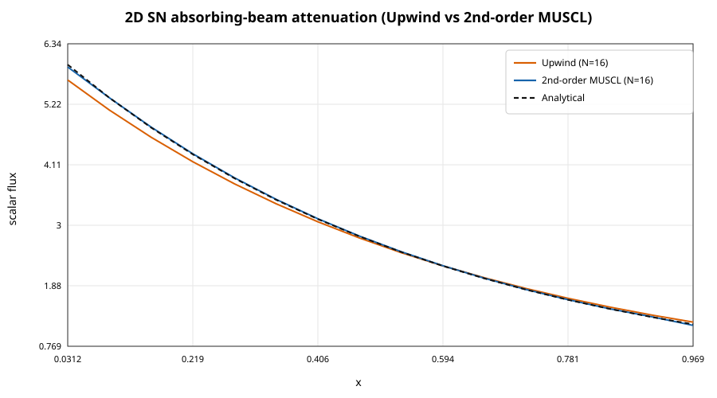

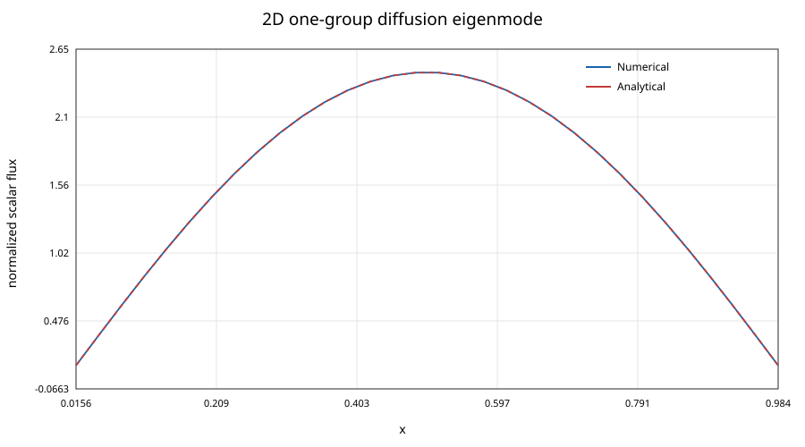

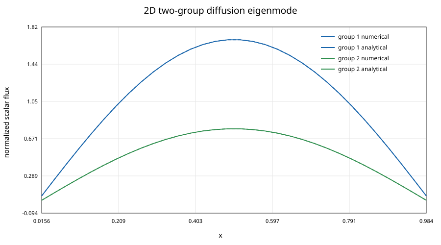

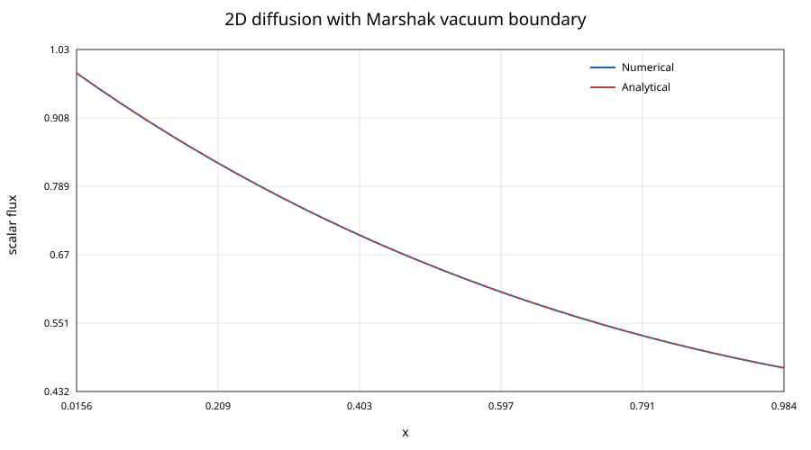

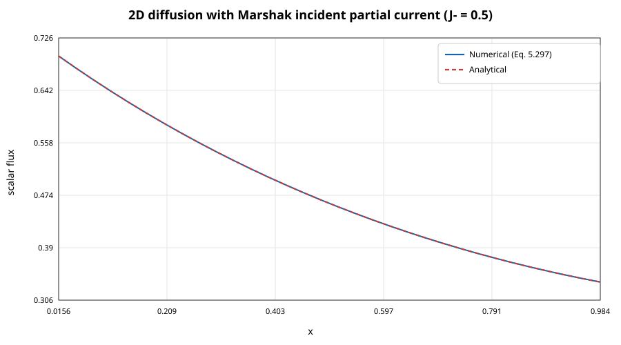

## Higher spatial eigenmodes, adjoint duality, kinetics, and perturbation

Two-group 2D square (`modes_base`, $32\times 32$ mesh) with 4 eigenmodes, exact discrete adjoint, delayed kinetics, and central thermal absorption perturbation ($\delta\Sigma_{a,2}=+0.01$ in $[0.25,0.75]^2$):

| Mode | Harmonic | Numerical k | Exact discrete k | |k error| | Dominance ratio | Residual |
|---:|---|---:|---:|---:|---:|---:|
| 0 | (1,1) | 1.0061060454 | 1.0061060454 | 5.33e-15 | 1.000000 | 4.73e-15 |
| 1 | (2,1) | 0.4323976754 | 0.4323976754 | 3.44e-15 | 0.429773 | 3.99e-15 |
| 2 | (1,2) | 0.4323976754 | 0.4323976754 | 1.22e-15 | 0.429773 | 1.62e-15 |
| 3 | (2,2) | 0.2754957910 | 0.2754957910 | 9.99e-16 | 0.273824 | 5.11e-11 |

- Adjoint duality: $|k^\dagger - k_0| = 0.00e+00$.
- Adjoint-weighted kinetics: $\beta_{\mathrm{eff}} = 0.0026784261$ (exact `0.0026784261`), $\Lambda_{\mathrm{eff}} = 2.666496e-07\ \mathrm{s}$ (exact `2.666496e-07`).
- First-order perturbation vs direct perturbed solve: $\delta k/k = -3.933944e-04$ vs $-3.931510e-04$ (relative difference **0.062%**).

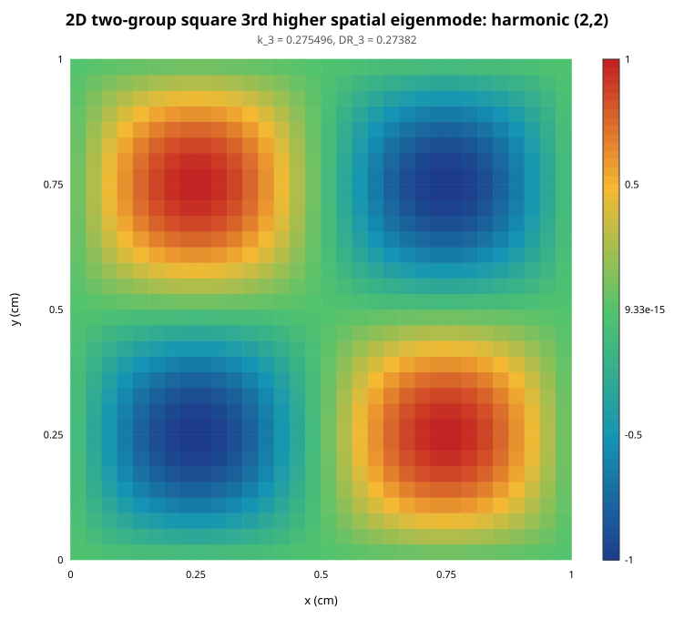

## Complex 2D benchmarks

### 1. 2D IAEA PWR quarter-core benchmark (ANL-7416 11-A2)

- Coarse mesh ($h = 5.0\ \mathrm{cm}$, 964 cells): $k_{\mathrm{eff}} = 1.029240$ (`-34.5` pcm vs reference `1.029585`), $\mathrm{DR} = 0.97184$, $|k^\dagger - k_{\mathrm{eff}}| = 4.05e-12$.
- Fine mesh ($h = 2.5\ \mathrm{cm}$, 3856 cells): $k_{\mathrm{eff}} = 1.029434$ (`-15.1` pcm), Richardson extrapolation $k_{\mathrm{Rich}} = 1.029499$ (`-8.6` pcm), peaking factor $F_q = 1.5445$.
- Central control-rod perturbation ($\delta\Sigma_{a,2} = -0.002$ in `rod_00`): 1st-order perturbation `+7.06` pcm vs direct solve `+7.26` pcm (**2.88%** difference).
- 6-group delayed kinetics on IAEA 2D: $\beta_{\mathrm{eff}} = 0.006490$, $\Lambda_{\mathrm{eff}} = 5.6651e-05\ \mathrm{s}$.

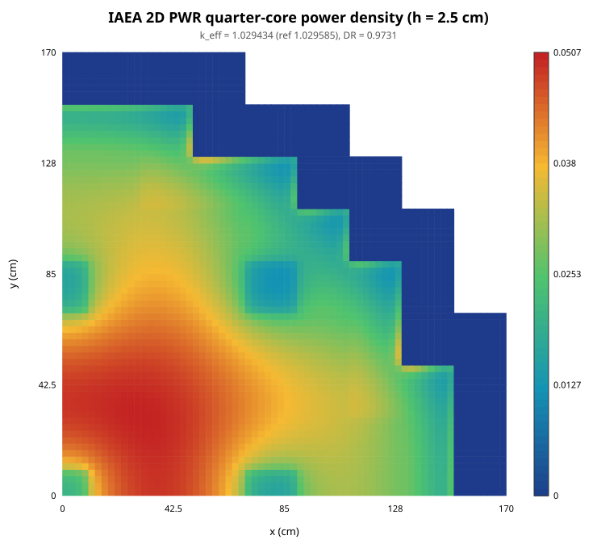

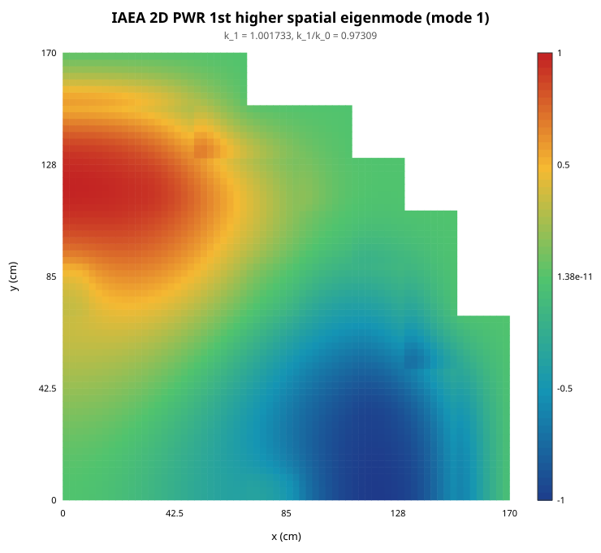

### 2. 2D TWIGL seed-blanket space-time kinetics benchmark

Initial steady-state $k_0 = 0.913101$ (ref `0.91321`, scaled critical at $t=0$).

| Time (s) | Step (computed) | Step (ref) | Step rel diff | Ramp (computed) | Ramp (ref) | Ramp rel diff |
|---:|---:|---:|---:|---:|---:|---:|
| 0.1 | 2.0608 | 2.061 | 0.01% | 1.3083 | 1.309 | 0.05% |
| 0.2 | 2.0782 | 2.078 | 0.01% | 1.9590 | 1.960 | 0.05% |
| 0.3 | 2.0956 | 2.095 | 0.03% | 2.0744 | 2.074 | 0.02% |
| 0.4 | 2.1131 | 2.113 | 0.00% | 2.0917 | 2.092 | 0.01% |
| 0.5 | 2.1308 | 2.131 | 0.01% | 2.1092 | 2.109 | 0.01% |

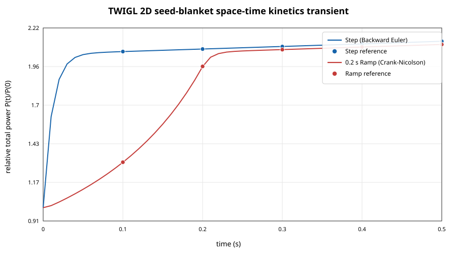

### 3. Reed 5-region heterogeneous $S_8$ benchmark with true void ($\Sigma_t = 0$) and DSA

- Source iterations reduced from **135** (unaccelerated) to **73** (DSA), a **1.85×** acceleration.
- Maximum scalar-flux discrepancy between DSA and unaccelerated $S_8$: **9.20e-11**; global balance = **6.83e-15**.

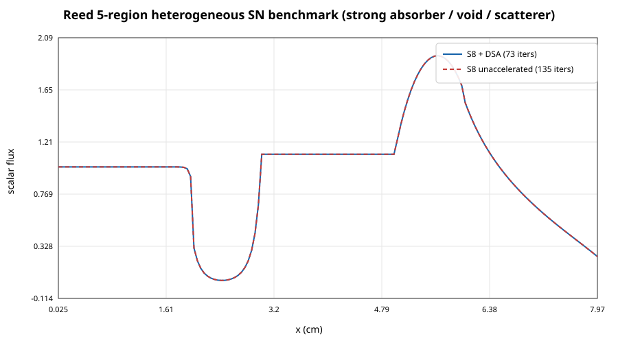

### 4. 2D fuel pin-cell ($P_1$ scattering) and $2\times 2$ UO$_2$/MOX/poison mini-assembly ($S_8$ + DSA)

- Pin-cell $S_8$ (specular): $k_{\mathrm{eff}} = 1.268729$, $k^\dagger = 1.268729$ (duality `4.23e-09`), $\Lambda_{\mathrm{eff}} = 3.0197e-05\ \mathrm{s}$.
- Pin-cell $S_8$ (white reflective): $k_{\mathrm{eff}} = 1.268309$ (`-42.0` pcm vs specular).
- Pin-cell Diffusion: $k_{\mathrm{eff}} = 1.280233$ (`+1150.4` pcm transport bias due to fuel thermal flux self-shielding).
- $2\times 2$ UO$_2$/MOX/poison mini-assembly $S_8$: $k_{\mathrm{eff}} = 0.697432$, $k^\dagger = 0.697432$, dominance ratio $\mathrm{DR} = 0.05095$ (3 modes converged).

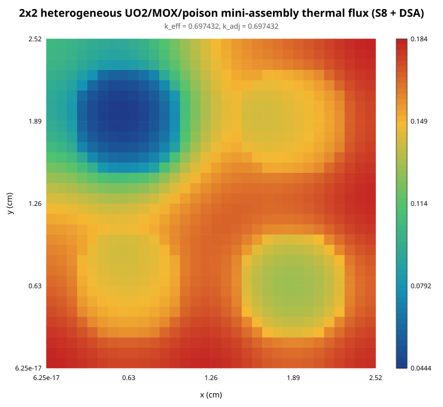

### 5. 2D Kobayashi-style dog-leg void-channel shielding

| Model / Angular set | Source (1,1) | Leg 1 (6,1) | Corner (6,7) | Exit (9.5,7) | Balance |
|---|---:|---:|---:|---:|---:|
| $S_4$ (12 dirs) | 2.8611 | 0.4399 | 0.2886 | 0.2437 | 1.63e-11 |
| $S_8$ (40 dirs) | 2.9402 | 0.5593 | 0.2476 | 0.2059 | 1.34e-11 |
| Product $8\times 32$ (128 dirs) | 2.9499 | 0.6678 | 0.2323 | 0.1902 | 3.36e-11 |
| Diffusion (void breakdown) | 0.7351 | 0.3794 | 0.3774 | 0.3768 | 2.94e-11 |

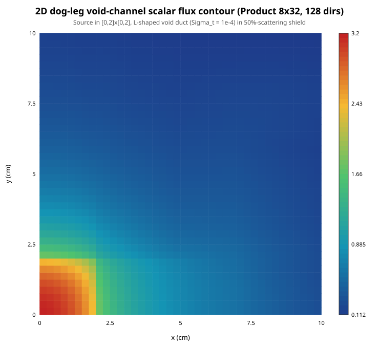

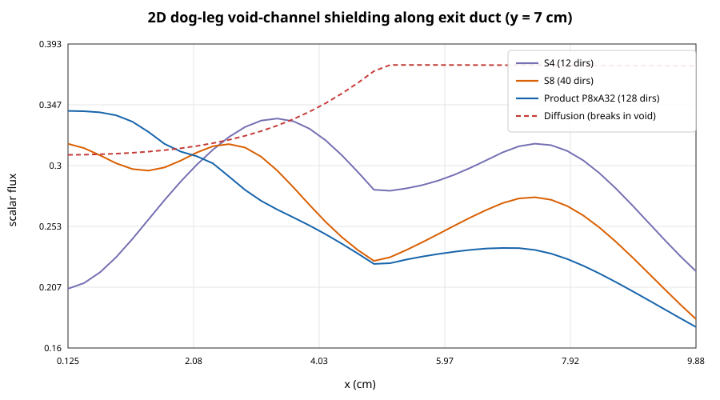

**All neutron validation checks passed.**
