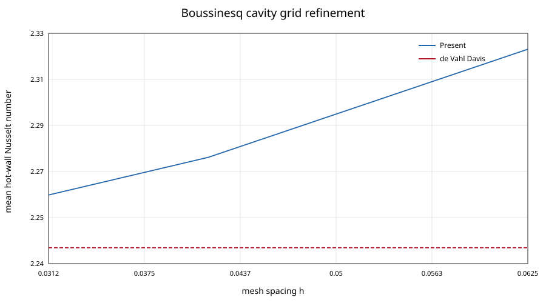

# Boussinesq thermal dilation and compressible flow: verification and validation report

## 1. Scope and conclusion

This report covers the two flow models added to the cell-centered SIMPLE solver:

- the incompressible Boussinesq approximation with a temperature-dependent buoyancy source and coupled energy transport;
- single-component ideal-gas compressible flow with density-dependent momentum and continuity, a pressure-correction equation containing density storage and pressure convection, and static-enthalpy energy transport with pressure work.

All **8 configured runs passed** the automated convergence, finite-state, conservation, analytical-error, benchmark, and grid-refinement checks. The main results are:

| Verification or benchmark | Finest-grid result |
|---|---:|
| de Vahl Davis cavity, mean hot-wall Nusselt number | `2.27680` versus `2.243` (`1.507%` error) |
| Cavity mid-plane maxima | `u_max = 16.0603`, `v_max = 19.1242` (`0.728%`, `2.512%`) |
| Zero-flow ideal-gas conduction, relative temperature/density errors | `3.079e-11`, `3.209e-11` |
| Closed uniform heating, relative temperature/pressure errors | `3.326e-11`, `3.308e-11` |
| Subsonic nozzle, relative pressure/density/temperature/velocity L2 errors | `0.969%`, `1.003%`, `0.0741%`, `0.695%` |

The converged-step maximum cell mass imbalance is below `7e-16` for the cavity, below `9e-16` for the conduction case, and below `1.8e-15` for all nozzle grids. Net boundary mass flux is below `4.1e-15` in those steady cases. The transient heating case conserves its constant density to a relative error of `3.63e-13`.

These results verify the implemented discretization against analytical solutions and validate the Boussinesq model against an established natural-convection benchmark. The nozzle comparison is against a quasi-one-dimensional isentropic reference, not experimental data. No shock-capturing, real-gas, compressible-turbulence, or high-Mach validation is claimed.

## 2. Implemented formulation

### 2.1 Boussinesq model

The implementation uses constant reference density in continuity, convection, diffusion, and time terms. Pressure is the hydrostatically modified pressure `p_rgh`. The integrated buoyancy source in cell `P` is

$$
\mathbf b_P=-\rho_0\beta(T_P-T_0)\mathbf gV_P.
$$

The cell volume is included explicitly. Other body forces are likewise integrated as `rho * f * V_P`.

The energy unknown is absolute temperature. For constant `cp`, the conservative equation is assembled as

$$
\frac{\partial\rho T}{\partial t}+\nabla\cdot(\rho\mathbf UT)
=\nabla\cdot\left[\left(\frac{k}{c_p}+\frac{\mu_t}{Pr_t}\right)\nabla T\right]
+\frac{q}{c_p}.
$$

It uses the same pressure-corrected mass flux as momentum. Fixed-temperature, zero-gradient/adiabatic, and inward-positive fixed-heat-flux boundaries are supported. The implementation is in `src/flow/EnergyModel.*`; the shared scalar operator in `src/fvm/ScalarTransport.*` now accepts separate current, old, and old-old density fields for conservative transient terms.

### 2.2 Ideal-gas compressible SIMPLE

The material law is

$$
\rho=\frac{p}{RT},\qquad \Psi=\left(\frac{\partial\rho}{\partial p}\right)_T=\frac\rho p.
$$

All compressible pressures are absolute and positive. Steady cases require at least one fixed-pressure boundary. Density is evaluated at every cell from the latest pressure and temperature; face mass fluxes use the corresponding interpolated or boundary density and Rhie–Chow momentum interpolation.

The pressure-correction matrix contains:

- the usual momentum-weighted pressure diffusion;
- `Psi * V * a0` density storage for transient calculations;
- upwind `Q* * Psi * p'` pressure convection on internal faces.

The same internal-face density correction is applied to the conservative mass flux. At boundaries without fixed pressure (including the prescribed-velocity inlet), density is deferred to the property update after the pressure/energy solve rather than included implicitly in that pressure solve. This avoids the inlet negative-diagonal startup instability observed during verification. At convergence the reported inlet and outlet mass fluxes agree to the same conservation tolerance.

Pressure is updated with `p += alpha_p p'`, followed immediately by an equation-of-state density update. Energy is then solved and density is updated again. Compressible pressure systems default to nonsymmetric BiCGStab/ILU.

The static-enthalpy temperature equation includes

$$
\frac{Dp}{Dt}=\frac{\partial p}{\partial t}+\mathbf U\cdot\nabla p,
$$

heat conduction, source heating, body-force work, and optional viscous dissipation. Momentum includes molecular transpose stress and the `-2 mu div(U)/3` dilatation term, consistently with the dissipation function. Current, old, and old-old density, pressure, velocity, and temperature histories are retained for backward Euler and BDF2.

Current limits are two-dimensional laminar flow, one ideal-gas component, and constant `cp`, viscosity, and conductivity. Temperature-dependent transport properties, real-gas equations of state, compressible turbulence, and dedicated shock capturing remain outside the implemented scope.

## 3. Reproduction and acceptance checks

Build and run the complete matrix in WSL Ubuntu:

```bash
make -j
make validate-thermal
```

The driver regenerates every mesh, executes the solver, and analyzes `validation/thermal_compressible_metrics.csv`. It also writes comparison CSV files under `validation/data/` and SVG plots under `validation/figures/`.

Automated gates require:

- convergence at every steady solve and every transient time step;
- finite velocity, pressure, temperature, and density, with positive compressible thermodynamic states;
- converged-step cell imbalance and net boundary mass flux below `1e-7` (the measured values are much smaller);
- cavity Nusselt error below 8%, mid-plane velocity-maximum errors below 15%, and decreasing Nusselt error with refinement;
- conduction and closed-heating analytical errors below `1e-9` and `1e-8`, respectively;
- nozzle pressure/density errors below 5%, temperature error below 1%, velocity error below 5%, and decreasing pressure error with refinement.

The tests use the C++17 `-O3` build, PETSc 3.21.0, MPICH 4.2.0, and Python standard-library validation scripts.

## 4. Boussinesq differentially heated cavity

### 4.1 Case and reference

The closed unit square has a hot left wall (`301`), cold right wall (`300`), adiabatic horizontal walls, and no-slip conditions on every wall. Gravity points downward. The dimensional-looking numerical parameters are selected to give the standard nondimensional parameters

$$
Pr=\frac{\nu}{\alpha}=0.71,\qquad
Ra=\frac{g\beta\Delta T L^3}{\nu\alpha}=10^4,
$$

with `rho = 1`, `mu = 0.71`, `k = 1`, `cp = 1`, `beta Delta T = 0.001`, and `g = 7.1e6`. Thus `alpha = 1`, and the dimensional velocities in the output are directly the benchmark's diffusion-scaled nondimensional velocities. First-order upwind convection is used for robustness in this grid study.

The reference is [de Vahl Davis's square-cavity benchmark](https://onlinelibrary.wiley.com/doi/10.1002/fld.1650030305): mean hot-wall Nusselt number `2.243`, maximum horizontal velocity on the vertical mid-plane `16.178`, and maximum vertical velocity on the horizontal mid-plane `19.617`. The reference values are also tabulated in the open comparison by [Khanafer et al.](https://pmc.ncbi.nlm.nih.gov/articles/PMC3605369/).

### 4.2 Results

The local Nusselt number is evaluated from the wall-cell conductive flux, `Nu = (T_hot - T_P)/(x_P Delta T)`, and averaged over the hot wall. Centerline velocities use the average of the two adjacent cell columns or rows.

| Grid | Cells | Iterations | Nu | Nu error | `u_max` | Error | `v_max` | Error |
|---|---:|---:|---:|---:|---:|---:|---:|---:|
| `16 x 16` | 256 | 456 | 2.348589 | 4.708% | 15.824074 | 2.188% | 18.441262 | 5.993% |
| `24 x 24` | 576 | 943 | 2.296155 | 2.370% | 15.940535 | 1.468% | 18.903639 | 3.636% |
| `32 x 32` | 1,024 | 1,592 | 2.276802 | 1.507% | 16.060286 | 0.728% | 19.124187 | 2.512% |

All three grids approach the benchmark from the expected first-order-upwind side, and all errors decrease with refinement. This verifies buoyancy sign, force integration, energy–momentum coupling, wall heat flux, and mass conservation together.



## 5. Ideal-gas conduction and equation of state

`cases/compressible_conduction/` is a zero-flow rectangle of length `0.1 m` with fixed temperatures `300 K` and `400 K` at its ends, adiabatic side walls, and absolute pressure `101325 Pa` at both ends. With constant conductivity and no flow, the exact solutions are

$$
T(x)=300+1000x,\qquad p=101325,\qquad \rho(x)=\frac{101325}{287T(x)}.
$$

The solver converges in two outer iterations. Its maximum velocity and pressure error are zero at printed precision; relative temperature and density L2 errors are `3.079e-11` and `3.209e-11`. This isolates thermal diffusion and the temperature-dependent equation of state without convective coupling.

The per-cell comparison is `validation/data/compressible_conduction.csv`.

A supplementary prescribed-flux run replaced the left fixed temperature with `fixedHeatFlux 2.5` and retained the right wall at `400 K`. The analytical profile is `T = 400 + 100(0.1-x)`. It converged in two outer iterations with a maximum temperature error of `1.04e-8 K`, confirming the inward-positive heat-flux sign and boundary source integration.

## 6. Closed transient uniform heating

`cases/compressible_closed_heating/` uses the same mesh, adiabatic no-slip walls, no fixed-pressure boundary, backward Euler with `dt = 0.01 s`, and ten steps to `t = 0.1 s`. A uniform source `q = 1000 W/m³` heats the closed gas volume. Since mass and volume are constant, density remains `rho0`, and the exact solution follows from `rho cv dT/dt = q` and the ideal-gas law:

$$
\rho_0=\frac{101325}{287\cdot300}=1.1768292683\ \mathrm{kg/m^3},
$$

$$
T(t)=300+\frac{qt}{\rho_0(c_p-R)},\qquad p(t)=\rho_0RT(t).
$$

At `t = 0.1 s`, the analytical values are `T = 300.1183483193 K` and `p = 101364.9721448 Pa`. The numerical ranges are `300.1183483291–300.1183483293 K` and `101364.9721482 Pa`; density remains `1.176829268293–1.176829268294 kg/m³`. Ten time steps take 540 outer iterations in total.

This case specifically verifies transient density storage in the pressure equation, pressure work in static enthalpy, constant-mass density behavior, and old-time-level updates. A steady-only test would not cover those terms. A supplementary BDF2 run over the same ten steps gives relative temperature, pressure, and density errors of `3.457e-11`, `3.505e-11`, and `3.628e-13`, respectively, also verifying the old-old time-level handling.

## 7. Subsonic isentropic converging nozzle

### 7.1 Geometry and analytical reference

The planar nozzle has length `4 m`, inlet height `0.2 m`, and outlet height `0.1 m`, with straight slip walls. The inviscid ideal gas has `R = 287 J/(kg K)`, `cp = 1005 J/(kg K)`, zero conductivity, and no viscous dissipation. Inlet conditions are `100 m/s`, `300 K`; the initial pressure is `100000 Pa`. The outlet pressure `72039.2491944 Pa` is computed from the quasi-one-dimensional subsonic isentropic solution and gives an exit Mach number of approximately `0.763` (inlet Mach `0.289`).

For local height `A(x)`, the reference solves

$$
u\left(\frac{T}{T_{in}}\right)^{(c_p-R)/R}=\frac{A_{in}}{A(x)}u_{in},
\qquad
T=T_{in}+\frac{u_{in}^2-u^2}{2c_p},
$$

$$
p=p_{in}\left(\frac{T}{T_{in}}\right)^{c_p/R},\qquad \rho=\frac{p}{RT}.
$$

The predicted exit state is `u = 252.8055 m/s`, `T = 273.1788 K`, `p = 72039.2492 Pa`, and `rho = 0.9188409 kg/m³`. These are the same steady isentropic relations used in compressible-nozzle references such as [Krumov, Penkova, and Zlateva (2021)](https://www.scientificbulletin.upb.ro/static/pdfs/full53d_123872.pdf).

All grids use first-order upwind convection, `velocity_relaxation = 0.3`, `pressure_relaxation = 0.02`, and `energy_relaxation = 0.3`. Small pressure relaxation is necessary for the velocity-inlet/pressure-outlet start from a uniform field; the fine case requires more outer iterations but converges without case-specific solver changes.

### 7.2 Errors and grid behavior

Relative L2 errors are weighted by local nozzle height and evaluated over every cell. The reference ignores transverse velocity and area-averaging details, so the errors include both numerical discretization error and the small two-dimensional/model-form difference.

| Grid | Cells | Iterations | Pressure L2 | Density L2 | Temperature L2 | Velocity L2 | Pressure order |
|---|---:|---:|---:|---:|---:|---:|---:|
| `40 x 4` | 160 | 3,439 | 1.881% | 2.005% | 0.1723% | 1.438% | — |
| `60 x 6` | 360 | 3,624 | 1.278% | 1.338% | 0.1043% | 0.930% | 0.953 |
| `80 x 8` | 640 | 5,645 | 0.969% | 1.003% | 0.0741% | 0.695% | 0.962 |

Every field error decreases with refinement. Pressure shows approximately first-order convergence, consistent with the upwind discretization. Maximum transverse velocity is `2.02`, `2.46`, and `2.66 m/s` on the three grids, small compared with the streamwise `100–253 m/s` range but evidence that the calculation is two-dimensional rather than an exact quasi-1D solver.


## 8. Artifacts and limitations

The machine-readable results are in `validation/thermal_compressible_metrics.csv`. Centerline and per-cell comparisons are under `validation/data/`. Case definitions and reproducible mesh generation are under:

- `cases/boussinesq_cavity/`;
- `cases/compressible_conduction/`;
- `cases/compressible_closed_heating/`;
- `cases/compressible_nozzle/`.

The current nozzle validation is subsonic and inviscid. It does not establish robustness at or above Mach one, across shocks, or with strongly non-orthogonal high-speed meshes. The pressure-based formulation is general in structure, but the present numerics are not a shock-capturing scheme. Boussinesq validation is at `Ra = 10^4` and `Pr = 0.71`; large-temperature-difference, low-Mach variable-property, and turbulent buoyant flows need separate validation.

The pressure-based all-speed formulation and the importance of conservative enthalpy and thermodynamic closure are discussed by [Evrard and van Wachem](https://arxiv.org/abs/2002.10482). The implementation here is segregated SIMPLE rather than their fully coupled pressure–velocity–temperature solver.
