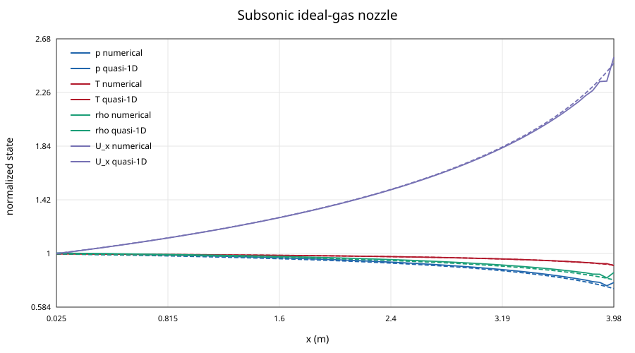
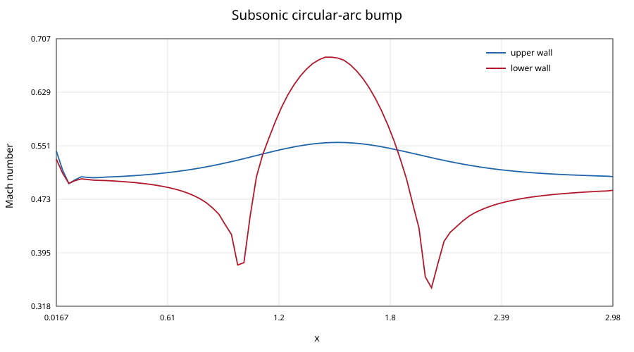
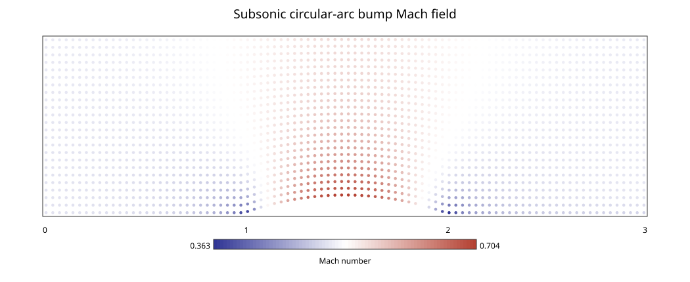
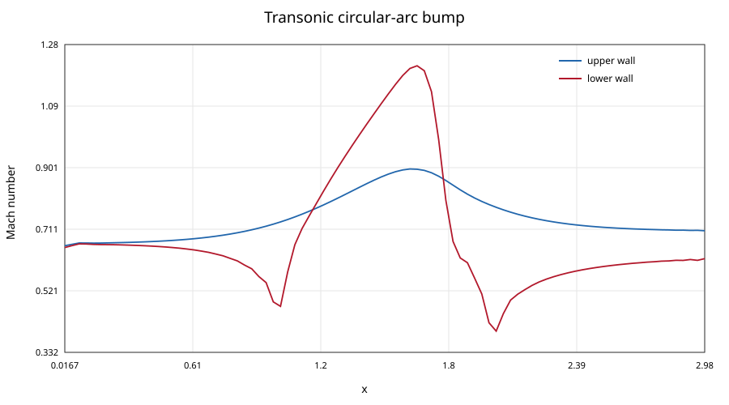
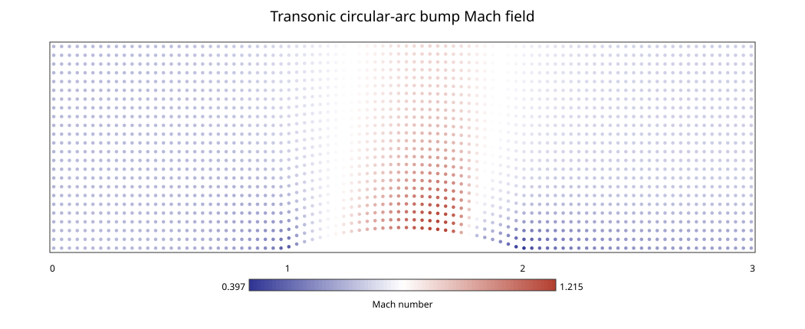
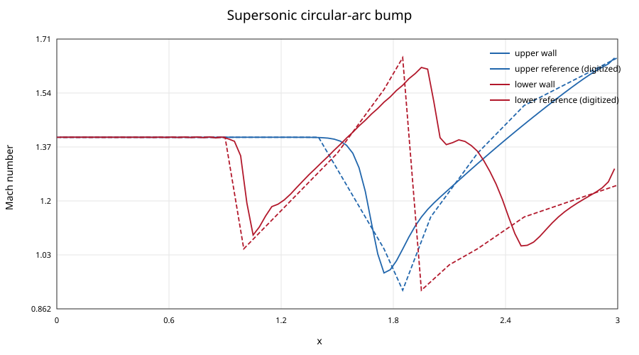
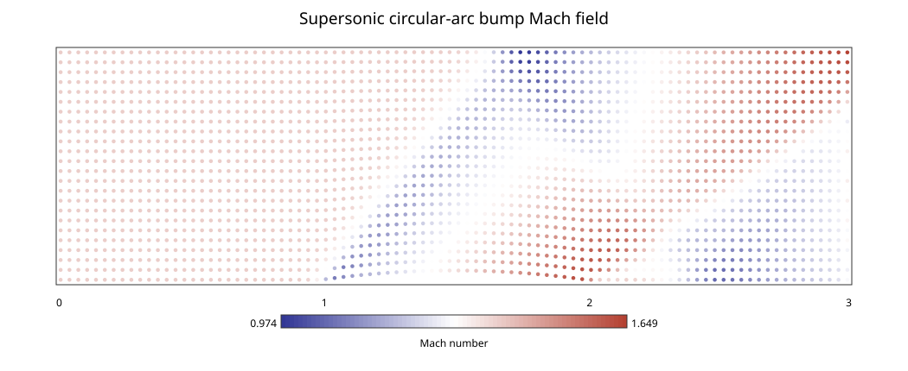

# Boussinesq thermal dilation and compressible flow: verification and validation report

## 1. Scope and conclusion

This report covers the two flow models added to the cell-centered SIMPLE solver:

- the incompressible Boussinesq approximation with a temperature-dependent buoyancy source and coupled energy transport;
- single-component ideal-gas compressible flow with density-dependent momentum and continuity, a pressure-correction equation containing density storage and pressure convection, and conservative total-enthalpy energy transport with pressure work and viscous-work fluxes.

All **11 configured runs passed** the automated convergence, finite-state, conservation, analytical-error, benchmark, and grid-refinement checks. The main results are:

| Verification or benchmark | Finest-grid result |
|---|---:|
| de Vahl Davis cavity, mean hot-wall Nusselt number | `2.26359` versus `2.243` (`0.918%` error) |
| Cavity mid-plane maxima | `u_max = 16.1891`, `v_max = 19.5548` (`0.0687%`, `0.3169%`) |
| Zero-flow ideal-gas conduction, relative temperature/density errors | `3.079e-11`, `3.209e-11` |
| Closed uniform heating, relative temperature/pressure errors | `3.326e-11`, `3.308e-11` |
| Subsonic nozzle, relative pressure/density/temperature/velocity L2 errors | `1.458%`, `1.490%`, `0.0737%`, `0.667%` |
| Subsonic bump, compressible SIMPLE | Exit Mach `0.50591`/`0.48621`; fore/aft symmetry error `0.04938`; net flux `2.31e-14` |
| Transonic bump, compressible SIMPLE | Exit Mach `0.70666`/`0.62065` versus `0.670`/`0.615`; shock `x = 1.767`; net flux `4.62e-14` |
| Supersonic bump, compressible SIMPLE | Wall-profile RMSE `0.12808`; net flux `1.96e-12` |

The converged-step maximum cell mass imbalance is below `7e-16` for the cavity, below `9e-16` for the conduction case, and below `1.8e-15` for all nozzle grids. Net boundary mass flux is below `4.1e-15` in those steady cases. The transient heating case conserves its constant density to a relative error of `3.63e-13`.

These results verify the implemented discretization against analytical solutions and validate the Boussinesq model against an established natural-convection benchmark. The nozzle comparison is against a quasi-one-dimensional isentropic reference, not experimental data. The three bump cases additionally validate the same pressure-based compressible SIMPLE solver in subsonic, transonic, and supersonic regimes against published numerical reference data. Real-gas and compressible-turbulence validation are not claimed. Shock validation is limited to the present second-order-upwind/Barth–Jespersen discretization.

## 2. Implemented formulation

### 2.1 Boussinesq model

The implementation uses constant reference density in continuity, convection, diffusion, and time terms. Pressure is the hydrostatically modified pressure `p_rgh`. The integrated buoyancy source in cell `P` is

$$
\mathbf b_P=-\rho_0\beta(T_P-T_0)\mathbf gV_P.
$$

The cell volume is included explicitly. Other body forces are likewise integrated as `rho * f * V_P`.

The energy unknown is absolute temperature. For constant `cp`, the conservative equation is assembled as

$$
\frac{\partial\rho T}{\partial t}+\nabla\cdot(\rho\mathbf UT)
=\nabla\cdot\left[\left(\frac{k}{c_p}+\frac{\mu_t}{Pr_t}\right)\nabla T\right]
+\frac{q}{c_p}.
$$

It uses the same pressure-corrected mass flux as momentum. Fixed-temperature, zero-gradient/adiabatic, and inward-positive fixed-heat-flux boundaries are supported. The implementation is in `src/flow/EnergyModel.*`; the shared scalar operator in `src/fvm/ScalarTransport.*` now accepts separate current, old, and old-old density fields for conservative transient terms.

### 2.2 Ideal-gas compressible SIMPLE

The material law is

$$
\rho=\frac{p}{RT},\qquad \Psi=\left(\frac{\partial\rho}{\partial p}\right)_T=\frac\rho p.
$$

All compressible pressures are absolute and positive. Steady cases require at least one fixed-pressure boundary. Density is evaluated at every cell from the latest pressure and temperature; face mass fluxes use the corresponding interpolated or boundary density and Rhie–Chow momentum interpolation.

The pressure-correction matrix contains:

- the usual momentum-weighted pressure diffusion;
- `Psi * V * a0` density storage for transient calculations;
- upwind `Q* * Psi * p'` pressure convection on internal faces.

The same internal-face density correction is applied to the conservative mass flux. At prescribed-velocity boundaries without fixed pressure, density is deferred to the property update after the pressure/energy solve rather than included implicitly in that pressure solve. This avoids the inlet negative-diagonal startup instability observed during verification. Extrapolated outgoing boundaries are the exception: their outgoing density correction is included directly in the pressure solve and mass-flux correction. At convergence the reported inlet and outlet mass fluxes agree to the same conservation tolerance.

Pressure is updated with `p += alpha_p p'`, followed immediately by an equation-of-state density update. Energy is then solved and density is updated again. Compressible pressure systems default to nonsymmetric BiCGStab/ILU.

The compressible energy unknown is total enthalpy `H0 = cp*T + K`, where `K = |U|^2/2`. The assembled equation is

$$
\frac{\partial\rho H}{\partial t}+\nabla\cdot(\rho\mathbf UH)
=\frac{\partial p}{\partial t}
+\nabla\cdot\left[\frac{k}{c_p}(\nabla H-\nabla K)\right]
+\nabla\cdot(\boldsymbol\tau\cdot\mathbf U)
+\rho\mathbf f\cdot\mathbf U+q .
$$

The total-enthalpy convection uses the pressure-corrected mass flux. The kinetic-energy diffusion correction and full viscous-work term are conservative owner/neighbour face fluxes, deferred between outer iterations. This retains both viscous dissipation and the stress-induced redistribution of macroscopic kinetic energy. Momentum includes the same molecular transpose stress and `-2 mu div(U)/3` dilatation term. Temperature is recovered as `T = (H0-K)/cp` after every energy solve; current, old, and old-old density, pressure, velocity, and total-enthalpy histories are retained for backward Euler and BDF2.

Current limits are two-dimensional laminar flow, one ideal-gas component, and constant `cp`, viscosity, and conductivity. Temperature-dependent transport properties, real-gas equations of state, and compressible turbulence remain outside the implemented scope. All flow regimes use the pressure-based SIMPLE path; no density-based solver is present.

### 2.3 High-Mach pressure-based treatment

The same `flow_model = compressible` formulation is used for the bump cases. Momentum and total-enthalpy convection use second-order upwind face reconstruction with a deferred correction to the implicit first-order upwind matrix. The pressure-correction equation retains the upwind density/pressure convection term. This gives the pressure equation the required upstream dependence in supersonic regions without introducing a Riemann solver. The bump cases enable `gradient_limiter = barth_jespersen`; the option defaults to `none` when it is not specified.

At a zero-gradient outlet with positive outgoing volumetric flux `Q_b`, the pressure matrix receives the additional diagonal coefficient `max(Q_b, 0) Psi_P`, and the boundary mass flux is corrected consistently:

$$
\dot m_b\leftarrow\dot m_b^*+\max(Q_b^*,0)\Psi_Pp_P'.
$$

This term is essential at a supersonic extrapolated outlet: omitting it leaves the density correction out of the mass balance. Fixed-pressure subsonic outlets instead use `p_b' = 0` and the momentum-weighted pressure correction. The bump calculations use prescribed static inlet velocity, absolute pressure, and temperature; their equivalent total conditions are reported below. These static inlets are not non-reflecting characteristic boundaries.

The Barth–Jespersen limiter constrains reconstructed face-centroid values to the local cell/neighbour range and is applied only to convective reconstruction. Pressure correction, Rhie–Chow interpolation, and diffusive gradients remain unlimited. Second-order reconstruction reduces numerical diffusion in smooth regions, while the limiter and specified momentum/thermal diffusion smear shocks over several cells. The nonsmooth limiter can make steady residual reduction oscillatory, so convergence is assessed using all field updates and mass imbalance rather than Mach profiles alone.

## 3. Reproduction and acceptance checks

Build and run the complete matrix in WSL Ubuntu:

```bash
make -j
make validate-thermal
```

The drivers regenerate every mesh, execute the solver, and analyze `validation/thermal_compressible_metrics.csv` and `validation/bump_metrics.csv`. They also write comparison CSV files under `validation/data/` and SVG plots under `validation/figures/`.

All convection uses second-order upwind reconstruction with an implicit first-order upwind matrix and deferred correction. The cavity, conduction, and closed-heating cases exercise the default unlimited path. The nozzle and bump cases explicitly enable the Barth–Jespersen limiter. There is no convection-blending option.

Automated gates require:

- convergence at every steady solve and every final transient step;
- finite velocity, pressure, temperature, and density, with positive compressible thermodynamic states;
- relative total-enthalpy closure `|H0-cp*T-|U|^2/2|/|H0|` below `1e-9` in every compressible cell;
- total-enthalpy relative L2 error below 1% for the adiabatic nozzle and below 3% for the bump flows;
- converged-step cell imbalance and net boundary mass flux below `1e-7` for the original eight cases and below `1e-4` for bump flows (measured bump values are much smaller);
- cavity Nusselt error below 8%, mid-plane velocity-maximum errors below 15%, and decreasing Nusselt error with refinement;
- conduction and closed-heating analytical errors below `1e-9` and `1e-8`, respectively;
- nozzle pressure/density errors below 5%, temperature error below 1%, velocity error below 5%, and decreasing pressure error with refinement;
- subsonic bump exit Mach error below `0.08` and fore/aft symmetry error below `0.08`;
- a transonic supersonic region and shock within `1.4 <= x <= 2.2`, with exit Mach errors below `0.10`;
- supersonic outlet Mach above one and approximate wall-profile RMSE below `0.40`.

The tests use the C++17 `-O3` build, PETSc 3.21.0, MPICH 4.2.0, and Python standard-library validation scripts.

## 4. Boussinesq differentially heated cavity

### 4.1 Case and reference

The closed unit square has a hot left wall (`301`), cold right wall (`300`), adiabatic horizontal walls, and no-slip conditions on every wall. Gravity points downward. The dimensional-looking numerical parameters are selected to give the standard nondimensional parameters

$$
Pr=\frac{\nu}{\alpha}=0.71,\qquad
Ra=\frac{g\beta\Delta T L^3}{\nu\alpha}=10^4,
$$

with `rho = 1`, `mu = 0.71`, `k = 1`, `cp = 1`, `beta Delta T = 0.001`, and `g = 7.1e6`. Thus `alpha = 1`, and the dimensional velocities in the output are directly the benchmark's diffusion-scaled nondimensional velocities. Second-order upwind convection is used without a gradient limiter, exercising the default reconstruction path in this grid study.

The reference is [de Vahl Davis's square-cavity benchmark](https://onlinelibrary.wiley.com/doi/10.1002/fld.1650030305): mean hot-wall Nusselt number `2.243`, maximum horizontal velocity on the vertical mid-plane `16.178`, and maximum vertical velocity on the horizontal mid-plane `19.617`. The reference values are also tabulated in the open comparison by [Khanafer et al.](https://pmc.ncbi.nlm.nih.gov/articles/PMC3605369/).

### 4.2 Results

The local Nusselt number is evaluated from the wall-cell conductive flux, `Nu = (T_hot - T_P)/(x_P Delta T)`, and averaged over the hot wall. Centerline velocities use the average of the two adjacent cell columns or rows.

| Grid | Cells | Iterations | Nu | Nu error | `u_max` | Error | `v_max` | Error |
|---|---:|---:|---:|---:|---:|---:|---:|---:|
| `16 x 16` | 256 | 525 | 2.319806 | 3.424% | 16.152268 | 0.159% | 19.266008 | 1.789% |
| `24 x 24` | 576 | 1,073 | 2.278168 | 1.568% | 16.152447 | 0.158% | 19.475293 | 0.722% |
| `32 x 32` | 1,024 | 1,640 | 2.263586 | 0.918% | 16.189116 | 0.0687% | 19.554831 | 0.317% |

All errors decrease with refinement. The second-order reconstruction is substantially more accurate for the mid-plane velocity maxima than the previous first-order results, while the Nusselt number continues to approach the benchmark from above. This verifies buoyancy sign, force integration, energy–momentum coupling, wall heat flux, and mass conservation together.


## 5. Ideal-gas conduction and equation of state

`cases/compressible_conduction/` is a zero-flow rectangle of length `0.1 m` with fixed temperatures `300 K` and `400 K` at its ends, adiabatic side walls, and absolute pressure `101325 Pa` at both ends. With constant conductivity and no flow, the exact solutions are

$$
T(x)=300+1000x,\qquad p=101325,\qquad \rho(x)=\frac{101325}{287T(x)}.
$$

The solver converges in two outer iterations. Its maximum velocity and pressure error are zero at printed precision; relative temperature and density L2 errors are `3.079e-11` and `3.209e-11`. This isolates thermal diffusion and the temperature-dependent equation of state without convective coupling.

The per-cell comparison is `validation/data/compressible_conduction.csv`.

A supplementary prescribed-flux run replaced the left fixed temperature with `fixedHeatFlux 2.5` and retained the right wall at `400 K`. The analytical profile is `T = 400 + 100(0.1-x)`. It converged in two outer iterations with a maximum temperature error of `1.04e-8 K`, confirming the inward-positive heat-flux sign and boundary source integration.

## 6. Closed transient uniform heating

`cases/compressible_closed_heating/` uses the same mesh, adiabatic no-slip walls, no fixed-pressure boundary, backward Euler with `dt = 0.01 s`, and ten steps to `t = 0.1 s`. A uniform source `q = 1000 W/m³` heats the closed gas volume. Since mass and volume are constant, density remains `rho0`, and the exact solution follows from `rho cv dT/dt = q` and the ideal-gas law:

$$
\rho_0=\frac{101325}{287\cdot300}=1.1768292683\ \mathrm{kg/m^3},
$$

$$
T(t)=300+\frac{qt}{\rho_0(c_p-R)},\qquad p(t)=\rho_0RT(t).
$$

At `t = 0.1 s`, the analytical values are `T = 300.1183483193 K` and `p = 101364.9721448 Pa`. The numerical ranges are `300.1183483291–300.1183483293 K` and `101364.9721482 Pa`; density remains `1.176829268293–1.176829268294 kg/m³`. Ten time steps take 540 outer iterations in total.

This case specifically verifies transient density storage in the pressure equation, the local pressure-rate term in total enthalpy, constant-mass density behavior, and old-time-level updates. A steady-only test would not cover those terms. A supplementary BDF2 run over the same ten steps gives relative temperature, pressure, and density errors of `3.457e-11`, `3.505e-11`, and `3.628e-13`, respectively, also verifying the old-old time-level handling.

## 7. Subsonic isentropic converging nozzle

### 7.1 Geometry and analytical reference

The planar nozzle has length `4 m`, inlet height `0.2 m`, and outlet height `0.1 m`, with straight slip walls. The inviscid ideal gas has `R = 287 J/(kg K)`, `cp = 1005 J/(kg K)`, zero conductivity, and no viscous dissipation. Inlet conditions are `100 m/s`, `300 K`; the initial pressure is `100000 Pa`. The outlet pressure `72039.2491944 Pa` is computed from the quasi-one-dimensional subsonic isentropic solution and gives an exit Mach number of approximately `0.763` (inlet Mach `0.289`).

For local height `A(x)`, the reference solves

$$
u\left(\frac{T}{T_{in}}\right)^{(c_p-R)/R}=\frac{A_{in}}{A(x)}u_{in},
\qquad
T=T_{in}+\frac{u_{in}^2-u^2}{2c_p},
$$

$$
p=p_{in}\left(\frac{T}{T_{in}}\right)^{c_p/R},\qquad \rho=\frac{p}{RT}.
$$

The predicted exit state is `u = 252.8055 m/s`, `T = 273.1788 K`, `p = 72039.2492 Pa`, and `rho = 0.9188409 kg/m³`. These are the same steady isentropic relations used in compressible-nozzle references such as [Krumov, Penkova, and Zlateva (2021)](https://www.scientificbulletin.upb.ro/static/pdfs/full53d_123872.pdf).

All grids use second-order upwind convection with `gradient_limiter = barth_jespersen`, `velocity_relaxation = 0.3`, `pressure_relaxation = 0.02`, and `energy_relaxation = 0.3`. The limiter is necessary to prevent a non-positive temperature during the velocity-inlet/pressure-outlet start from a uniform field. Small pressure relaxation is also necessary; the fine case requires more outer iterations but converges without case-specific solver changes.

### 7.2 Errors and grid behavior

Relative L2 errors are weighted by local nozzle height and evaluated over every cell. The reference ignores transverse velocity and area-averaging details, so the errors include both numerical discretization error and the small two-dimensional/model-form difference.

| Grid | Cells | Iterations | Pressure L2 | Density L2 | Temperature L2 | Velocity L2 | Pressure order |
|---|---:|---:|---:|---:|---:|---:|---:|
| `40 x 4` | 160 | 3,171 | 1.770% | 1.884% | 0.1517% | 1.373% | — |
| `60 x 6` | 360 | 3,773 | 1.404% | 1.467% | 0.1029% | 0.868% | 0.571 |
| `80 x 8` | 640 | 7,805 | 1.458% | 1.490% | 0.0737% | 0.667% | -0.131 |

Temperature and velocity errors decrease on every grid. Fine-grid pressure and density errors remain below their coarse-grid values but increase slightly relative to the medium grid, so this three-grid study does not establish a reliable pressure convergence order. The quasi-one-dimensional reference also neglects the transverse velocity and area-averaging details present in the two-dimensional result. Maximum transverse velocity is `1.87`, `2.24`, and `2.48 m/s` on the three grids, small compared with the streamwise `100–253 m/s` range but evidence that the calculation is two-dimensional rather than an exact quasi-1D solver.



## 8. Circular-arc bump flow

### 8.1 Geometry, numerics, and references

The channel has length `3` and height `1`. A circular-arc bump of chord `1` is centered on the lower wall between `x = 1` and `x = 2`. With bump height `h`, the arc is

$$
R=\frac{h^2+0.5^2}{2h},\qquad y=h-R+\sqrt{R^2-(x-1.5)^2}.
$$

The subsonic and transonic cases use `h = 0.1`; supersonic uses `h = 0.04`. All use the same body-fitted `90 x 24` quadrilateral topology (2,160 cells), `R = 287 J/(kg K)`, and `cp = 1005 J/(kg K)`. They are steady pressure-based SIMPLE calculations with second-order upwind momentum and energy convection and `gradient_limiter = barth_jespersen`. The subsonic case uses `viscosity = thermal_conductivity = 0.5`; the transonic and supersonic cases use `2.0` to stabilize the nonsmooth shock calculations. Consistent viscous dissipation is enabled. These are numerical stabilization values, not a physical molecular-viscosity calibration.

Each inlet prescribes static velocity, absolute pressure, and temperature. This fixes inlet mass flux and avoids the pressure drift observed with a fixed-velocity/zero-gradient-static-pressure inlet on this collocated grid. The corresponding total conditions match the reference flow conditions, but the static inlet is not a non-reflecting characteristic boundary. Subsonic/transonic outlets prescribe static pressure; the supersonic outlet extrapolates all primitive variables and applies the outgoing density correction described in section 2.3.

The case definitions and downloaded reference plots are collected in `reference/bump/README.md`. Principal sources are:

- [SU2's Inviscid Bump tutorial](https://su2code.github.io/tutorials/Inviscid_Bump/) for channel geometry and reference flow conditions;
- [Kasturi Rangan and Ghosh (2022)](https://www.frontiersin.org/journals/mechanical-engineering/articles/10.3389/fmech.2022.903492/full), Table 2, for transonic exit Mach numbers `0.670` (top) and `0.615` (bottom), citing Favini et al. (1996);
- [Djavareshkian and Farnak (2008)](https://scialert.net/fulltext/?doi=jas.2008.3361.3370) for the transonic and supersonic wall-profile comparisons;
- [Ma, Emad, and Chen (2008)](https://scialert.net/fulltext/?doi=srj.2008.1.16) for additional wall-pressure data and pressure contours;
- [A parallel pressure implicit splitting of operators algorithm applied to flows at all speeds](https://eprints.soton.ac.uk/21853/1/bres_01.pdf) for the nearly symmetric `M = 0.5` subsonic solution.

The supersonic CSV reference is approximate plot digitization, not tabulated author data. Its reading uncertainty is approximately `0.05` Mach units. The transonic exit values are directly tabulated literature values.

### 8.2 Subsonic bump, inlet Mach 0.5

The prescribed static inlet is `T = 300 K`, `p = 85418.91795 Pa`, and `U = 173.5943547 m/s`, equivalent to total temperature `315 K` and total pressure `101325 Pa` at Mach `0.5`. Outlet static pressure is `84606.375 Pa`, corresponding to isentropic exit Mach `0.514156`. The steady second-order-upwind SIMPLE run with Barth–Jespersen limiting converged in 8,278 outer iterations with `tolerance = 1e-3`. The solution remains subsonic throughout, with `max(M) = 0.679490`. The measured upper/lower exit Mach values are `0.505909` and `0.486206`, with absolute errors `0.008247` and `0.027950` from the isentropic reference. The maximum lower-wall fore/aft symmetry discrepancy is `0.049384`, consistent with a nearly symmetric solution but with measurable reconstruction/dissipation effects. Final net boundary mass flux is `2.309e-14` and maximum cell imbalance is `1.78e-15`.





### 8.3 Transonic bump, inlet Mach 0.675

The prescribed static inlet is `T = 289.8146409 K`, `p = 103551.51194 Pa`, and `U = 230.3397546 m/s`, equivalent to the SU2 total conditions `T0 = 316.224 K` and `p0 = 140513.23 Pa` at Mach `0.675`. Outlet static pressure is `101300 Pa`. The steady second-order-upwind SIMPLE run with Barth–Jespersen limiting converged in 41,619 outer iterations with `tolerance = 1e-3`. A supersonic pocket forms over the bump, with `max(M) = 1.218193` and the strongest lower-wall deceleration at `x = 1.766667`, within the documented shock region.

| Quantity | Present | Literature | Absolute error |
|---|---:|---:|---:|
| Exit Mach, upper wall | 0.706656 | 0.670 | 0.036656 |
| Exit Mach, lower wall | 0.620654 | 0.615 | 0.005654 |

The final net boundary mass flux is `4.619e-14` and maximum cell imbalance is `7.11e-15`. The result has `min(M) = 0.395580`, `max(M) = 1.218193`, and satisfies the reference exit-Mach and shock-location acceptance criteria. The second-order reconstruction and limiter produce a distinct shock profile whose thickness and peak remain grid- and dissipation-dependent.





### 8.4 Supersonic bump, inlet Mach 1.4

The supersonic inlet prescribes `T = 300 K`, `p = 101325 Pa`, and velocity `486.0641933 m/s` (Mach `1.4`); the outlet is zero-gradient for velocity, pressure, and temperature. The steady second-order-upwind SIMPLE run with Barth–Jespersen limiting converged in 87,423 outer iterations with `tolerance = 5e-3`. At convergence the maximum absolute pressure update is below `0.005 Pa` and the measured maximum velocity update is `3.12e-6 m/s`; temperature, density, and continuity satisfy their individual gates. The final field has `min(M) = 0.976820` and `max(M) = 1.652398`, with the strongest lower-wall deceleration near `x = 2.033`. The outlet remains supersonic on both walls, with Mach values `1.652398` and `1.309948` on the upper and lower walls. The approximate wall-profile RMSE is `0.128080` against the digitized UNO data. Final net boundary mass flux is `1.965e-12` and maximum cell imbalance is `1.10e-13`.





## 9. Artifacts and limitations

The original machine-readable results are in `validation/thermal_compressible_metrics.csv`; bump results are in `validation/bump_metrics.csv`. Centerline and per-cell comparisons are under `validation/data/`. Case definitions and reproducible mesh generation are under:

- `cases/boussinesq_cavity/`;
- `cases/compressible_conduction/`;
- `cases/compressible_closed_heating/`;
- `cases/compressible_nozzle/`;
- `cases/compressible_bump/`.

The nozzle validation is subsonic and inviscid; the bump cases provide the Mach-one and supersonic coverage. All bump regimes use the same pressure-based SIMPLE implementation with second-order upwind convection, Barth–Jespersen limiting, upwind pressure correction, and consistent compressible outflow correction. No density-based solver or Riemann flux is used. Shock thickness and profile errors remain grid-, limiter-, and dissipation-dependent, and the prescribed static inlets are not non-reflecting characteristic boundaries. Boussinesq validation is at `Ra = 10^4` and `Pr = 0.71`; large-temperature-difference, low-Mach variable-property, and turbulent buoyant flows need separate validation.

The pressure-based all-speed formulation and the importance of conservative enthalpy and thermodynamic closure are discussed by [Evrard and van Wachem](https://arxiv.org/abs/2002.10482). The implementation here is segregated SIMPLE rather than their fully coupled pressure–velocity–temperature solver.
